<picture>
  <source media="(prefers-color-scheme: dark)" srcset=".github/assets/header-dunkel.svg">
  
</picture>

     

<h3 align="center">Coding agents, and everything that keeps them on track.</h3>

Terminal and editor coding agents plus the setups, parallel runners, spec workflows, code context, usage trackers and review tools around them. Each repo sits where it does its job, not by star count.

<!-- onboarding:start -->
### In 3 Minuten startklar

<picture>
  <source media="(prefers-color-scheme: dark)" srcset=".github/assets/onboarding-dunkel.svg">
  
</picture>

1. **Start here.** Oben unter [Start here](#start-here) stehen 4 Picks, einer je Rolle. Fang mit dem an, der zu deiner Lücke passt.
2. **Rubrik.** Unter [Contents](#contents) die Rubrik wählen: jedes Repo steht genau einmal da, nach der Aufgabe, die es erledigt.
3. **Ausprobieren.** Den Pick öffnen und seine Install-Zeile ausführen; die Sterne zeigen, wie viele ihn schon nutzen.
4. **Dranbleiben.** Dieser Liste einen Stern geben: neue Picks erscheinen in deinem GitHub-Feed.

**Was du davon hast**

- Die Repos rund um Coding Agents an einem Ort, nach Aufgabe sortiert, statt tagelang selbst zu suchen.
- Jeder Pick sagt in einem Satz, wofür er gut ist.
- Aufgenommen wird nur, was öffentlich ist, eine Lizenz hat und heute läuft.

**Nächster Schritt:** Fehlt ein Repo? Über [CONTRIBUTING.md](CONTRIBUTING.md) vorschlagen, ein Satz zur Aufgabe genügt; mehr Listen auf [github.com/Wellux](https://github.com/Wellux).
<!-- onboarding:end -->

## New this week

Starred in the last seven days. Each one also sits in its section below.

- [jetbrains-cc-gui](https://github.com/zhukunpenglinyutong/jetbrains-cc-gui) `★ 7.7k` · IDE GUI plugin for running Claude Code and Codex from JetBrains products. In [Desktop and web workbenches](#desktop-and-web-workbenches).
- [lean-ctx](https://github.com/yvgude/lean-ctx) `★ 4k` · Selects task-relevant context for coding agents, exposed via CLI, MCP and hooks. In [Token savers](#token-savers).
- [tokenjuice](https://github.com/vincentkoc/tokenjuice) `★ 543` · Compacts terminal output to cut token use in agent workflows, as a CLI or agent extension. In [Token savers](#token-savers).
- [twinny](https://github.com/twinnydotdev/twinny) `★ 3.7k` · VS Code extension for code completion, chat and agent edits with local or hosted models. In [Editor and IDE agents](#editor-and-ide-agents).
- [agent-orchestration-standard](https://github.com/tomtomsatnav/agent-orchestration-standard) `★ 104` · Local dashboard that replays Claude Code sessions with agent graphs, tokens and alerts. In [Sessions and provenance](#sessions-and-provenance).
- [tinybar](https://github.com/ThiloReintjes/tinybar) `★ 85` · Menu-bar monitor for coding-agent subscription limits, token history and API-equivalent cost. In [Usage, quota and cost monitors](#usage-quota-and-cost-monitors).
- [testzeus-hercules](https://github.com/test-zeus-ai/testzeus-hercules) `★ 1.2k` · AI agent that runs UI, API and accessibility tests without writing test code. In [Testing and QA agents](#testing-and-qa-agents).
- [stagewise](https://github.com/stagewise-io/stagewise) `★ 6.8k` · Editor-based IDE that creates, orchestrates and previews coding agents across models. In [Editor and IDE agents](#editor-and-ide-agents).
- [ralph](https://github.com/snarktank/ralph) `★ 22.3k` · Autonomous agent loop that runs repeatedly until all PRD items are complete. In [Agent loops](#agent-loops).
- [dori-superagent](https://github.com/sisyphuslabs/dori-superagent) `★ 241` · Runs a lead agent with parallel coding lanes and gated merges on the herdr harness. In [Herdr ecosystem](#herdr-ecosystem).
- [vibe-tree](https://github.com/sahithvibudhi/vibe-tree) `★ 273` · Runs parallel AI coding agents in separate git worktrees via desktop, web or CLI. In [Parallel worktrees and boards](#parallel-worktrees-and-boards).
- [billion-context](https://github.com/ranxianglei/billion-context) `★ 7.6k` · Context-compression plugin that keeps long agent sessions and small context windows usable. In [Token savers](#token-savers).
- [pullboard](https://github.com/pullboard-dev/pullboard) `★ 836` · Governed coding agents build from approved specs, with a second agent verifying before merge. In [Software factories](#software-factories).
- [peon-ping](https://github.com/PeonPing/peon-ping) `★ 5.1k` · Plays voice notifications from coding agents and IDEs to signal task events. In [Claude Code hooks, status lines and mods](#claude-code-hooks-status-lines-and-mods).
- [arbor](https://github.com/penso/arbor) `★ 846` · Native desktop GUI for running agentic coding in Git worktrees with terminals and diffs. In [Desktop and web workbenches](#desktop-and-web-workbenches).
- [claude-code-my-workflow](https://github.com/pedrohcgs/claude-code-my-workflow) `★ 1.7k` · Offers a Claude Code template for academic research with multi-agent review and quality gates. In [Claude Code setups and frameworks](#claude-code-setups-and-frameworks).
- [core](https://github.com/opensumi/core) `★ 3.7k` · Framework for building AI-native IDE products with MCP client support. In [Editor and IDE agents](#editor-and-ide-agents).
- [codex-security](https://github.com/openai/codex-security) `★ 13.7k` · CLI and SDK that find, validate and propose fixes for code vulnerabilities. In [AI code review](#ai-code-review).
- [Backlog.md](https://github.com/MrLesk/Backlog.md) `★ 7.4k` · Manages tasks in markdown in git for collaboration between humans and AI agents. In [Plans and task trackers for agents](#plans-and-task-trackers-for-agents).
- [hunk](https://github.com/modem-dev/hunk) `★ 9.8k` · Terminal diff viewer for reviewing agent-written changes before merge. In [AI code review](#ai-code-review).
- [TokenEconomizer](https://github.com/microsoft/TokenEconomizer) `★ 6.9k` · Cuts coding-agent token costs through experience-driven black-box cost control. In [Token savers](#token-savers).
- [cmux](https://github.com/manaflow-ai/cmux) `★ 28.8k` · Ghostty-based macOS terminal that runs several coding agents with tabs and notifications. In [Desktop and web workbenches](#desktop-and-web-workbenches).
- [Lody](https://github.com/LodyAI/Lody) `★ 1.8k` · Shares coding agent sessions with a team across phone and desktop clients. In [Mobile and web access](#mobile-and-web-access).
- [herdr-agent-usage](https://github.com/levi-qiao/herdr-agent-usage) `★ 161` · Herdr plugin that shows per-credential usage, context and cache for many coding agents. In [Herdr ecosystem](#herdr-ecosystem).
- [kilocode](https://github.com/Kilo-Org/kilocode) `★ 28k` · Open-source coding agent for VS Code, JetBrains and the terminal. In [Editor and IDE agents](#editor-and-ide-agents).
- [agentsview](https://github.com/kenn-io/agentsview) `★ 6.5k` · Searches, analyzes and reports token use for coding agent sessions across many agents. In [Sessions and provenance](#sessions-and-provenance).
- [alethe-agents](https://github.com/Kc1t/alethe-agents) `★ 1.2k` · Desktop workspace that runs and resumes several coding agents and shells in split panes. In [Desktop and web workbenches](#desktop-and-web-workbenches).
- [awesome-claude-code-mods](https://github.com/karanb192/awesome-claude-code-mods) `★ 1k` · Curated list of Claude Code mods that states what each one can access before install. In [Claude Code hooks, status lines and mods](#claude-code-hooks-status-lines-and-mods).
- [tokscale](https://github.com/junhoyeo/tokscale) `★ 5.9k` · Tracks token usage and cost across several AI coding agents from the terminal. In [Usage, quota and cost monitors](#usage-quota-and-cost-monitors).
- [shadcn-ui-mcp-server](https://github.com/Jpisnice/shadcn-ui-mcp-server) `★ 3.1k` · MCP server giving coding agents current shadcn/ui component docs, usage and install steps. In [Repo packers and live docs](#repo-packers-and-live-docs).
- [memdoor](https://github.com/guregodevo/memdoor) `★ 407` · Open-source terminal coding agent that spreads work across a team of small models. In [Terminal agents](#terminal-agents).
- [abtop](https://github.com/graykode/abtop) `★ 3.9k` · Terminal monitor for Claude Code and Codex sessions: tokens, context, rate limits, ports. In [Usage, quota and cost monitors](#usage-quota-and-cost-monitors).
- [gptme](https://github.com/gptme/gptme) `★ 4.5k` · Terminal agent with local tools for writing code, running commands and browsing the web. In [Terminal agents](#terminal-agents).
- [golutra](https://github.com/golutra/golutra) `★ 3.9k` · Desktop workspace that runs Codex, Claude Code and OpenClaw in parallel with task orchestration. In [Desktop and web workbenches](#desktop-and-web-workbenches).
- [codeburn](https://github.com/getagentseal/codeburn) `★ 11.8k` · Tracks token usage and cost of AI coding tools by model, project and task, locally. In [Usage, quota and cost monitors](#usage-quota-and-cost-monitors).
- [gentle-ai](https://github.com/Gentleman-Programming/gentle-ai) `★ 9.3k` · Installer that configures several coding agents with memory, skills, MCP servers and personas. In [Claude Code setups and frameworks](#claude-code-setups-and-frameworks).
- [emdash](https://github.com/generalaction/emdash) `★ 6.3k` · Desktop environment that runs several coding agents in parallel, each in its own worktree. In [Parallel worktrees and boards](#parallel-worktrees-and-boards).
- [conductor](https://github.com/gemini-cli-extensions/conductor) `★ 3.8k` · Plugin that adds spec-driven development to Antigravity and Claude Code agents. In [Specs and task plans](#specs-and-task-plans).
- [agmsg](https://github.com/fujibee/agmsg) `★ 1.6k` · Lets Claude Code, Codex, Gemini and Copilot agents message each other via Bash and SQLite. In [Councils and second opinions](#councils-and-second-opinions).
- [Prometheus](https://github.com/EuniAI/Prometheus) `★ 1.2k` · Maps a codebase as a knowledge graph and has an AI agent locate and repair bugs in it. In [Autonomous software engineers](#autonomous-software-engineers).
- [cogit](https://github.com/erensrtky/cogit) `★ 190` · Records the decisions behind agent-written code and links each commit to them. In [Sessions and provenance](#sessions-and-provenance).
- [shepherdr](https://github.com/eliasstravik/shepherdr) `★ 1.2k` · Herdr plugin that drives many coding agents on several machines from a phone or desktop. In [Herdr ecosystem](#herdr-ecosystem).
- [python-ai-optimized-codebase](https://github.com/dynamous-business/python-ai-optimized-codebase) `★ 11` · Python starter codebase structured so AI coding assistants can work on it effectively. In [Vibe coding](#vibe-coding).
- [nextjs-ai-optimized-codebase](https://github.com/dynamous-business/nextjs-ai-optimized-codebase) `★ 17` · Next.js starter codebase structured for AI coding assistants such as Claude Code. In [Vibe coding](#vibe-coding).
- [factory-v1-sandbox](https://github.com/coleam00/factory-v1-sandbox) `★ 2` · Throwaway sandbox for testing the Archon software-factory pack with Codex. In [Software factories](#software-factories).
- [Codewhale](https://github.com/codewhale-hq/Codewhale) `★ 41.2k` · Rust terminal coding agent that works with any model and runs multiple agents per task. In [Terminal agents](#terminal-agents).
- [xum](https://github.com/coder/xum) `★ 2.1k` · Desktop app that runs several coding agents in isolated parallel workspaces. In [Parallel worktrees and boards](#parallel-worktrees-and-boards).
- [plannotator](https://github.com/backnotprop/plannotator) `★ 12.2k` · Annotates agent plans and code changes in a review workspace and sends feedback to the agent. In [AI code review](#ai-code-review).
- [PiDeck](https://github.com/ayuayue/PiDeck) `★ 1.2k` · Electron desktop workbench that manages Pi, DSH and ACP agent sessions across local projects. In [Pi ecosystem](#pi-ecosystem).
- [ccpm](https://github.com/automazeio/ccpm) `★ 8.5k` · Agent skills that plan work as GitHub Issues and run tasks in parallel git worktrees. In [Plans and task trackers for agents](#plans-and-task-trackers-for-agents).
- [obsidian-herdr](https://github.com/AgriciDaniel/obsidian-herdr) `★ 21` · Obsidian plugin that runs coding agent CLIs in persistent Herdr terminals with a vault bridge. In [Herdr ecosystem](#herdr-ecosystem).
- [agent-of-empires](https://github.com/agent-of-empires/agent-of-empires) `★ 4.6k` · Runs and manages several coding-agent CLIs side by side from a terminal UI or web app. In [Parallel worktrees and boards](#parallel-worktrees-and-boards).
- [jcode](https://github.com/1jehuang/jcode) `★ 21.8k` · Rust coding agent harness for terminal workflows that run several agents at once. In [Terminal agents](#terminal-agents).

## Start here

No time for 511 repos? Start with these 4, one per role. Add the rest when you feel the gap.

| Role | Pick | Why |
|:--|:--|:--|
| **Agent** | [opencode](https://github.com/anomalyco/opencode) `★ 227.2k` | Open-source terminal coding agent with build and plan agents and a desktop app |
| **Spec** | [spec-kit](https://github.com/github/spec-kit) `★ 150k` | Write the spec and task plan first so the agent builds the right thing |
| **Parallel** | [vibe-kanban](https://github.com/BloopAI/vibe-kanban) `★ 28.7k` | Run several coding agents side by side from one kanban board |
| **Review** | [pr-agent](https://github.com/The-PR-Agent/pr-agent) `★ 16.3k` | Reviews each pull request the agents open before you merge it |

<picture>
  <source media="(prefers-color-scheme: dark)" srcset=".github/assets/map-dunkel.svg">
  
</picture>

## Contents

- [Coding agents](#coding-agents) · 73 [Terminal agents](#terminal-agents) · [Editor and IDE agents](#editor-and-ide-agents) · [Autonomous software engineers](#autonomous-software-engineers) · [Prompt-to-app builders](#prompt-to-app-builders) · [Rebuilt and dissected agents](#rebuilt-and-dissected-agents)
- [Pi and Herdr](#pi-and-herdr) · 52 [Pi ecosystem](#pi-ecosystem) · [Herdr ecosystem](#herdr-ecosystem)
- [Setups and mods](#setups-and-mods) · 61 [Claude Code setups and frameworks](#claude-code-setups-and-frameworks) · [Claude Code hooks, status lines and mods](#claude-code-hooks-status-lines-and-mods) · [Codex and OpenCode add-ons](#codex-and-opencode-add-ons) · [Copilot, Cursor, Gemini and Antigravity add-ons](#copilot-cursor-gemini-and-antigravity-add-ons)
- [Accounts and usage](#accounts-and-usage) · 28 [Account and provider switchers](#account-and-provider-switchers) · [Usage, quota and cost monitors](#usage-quota-and-cost-monitors)
- [Parallel agents](#parallel-agents) · 81 [Parallel worktrees and boards](#parallel-worktrees-and-boards) · [Desktop and web workbenches](#desktop-and-web-workbenches) · [Mobile and web access](#mobile-and-web-access) · [Background and cloud runners](#background-and-cloud-runners) · [Councils and second opinions](#councils-and-second-opinions)
- [Specs, loops and factories](#specs-loops-and-factories) · 67 [Specs and task plans](#specs-and-task-plans) · [Plans and task trackers for agents](#plans-and-task-trackers-for-agents) · [Agent loops](#agent-loops) · [Software factories](#software-factories)
- [Review, tests and provenance](#review-tests-and-provenance) · 46 [AI code review](#ai-code-review) · [Testing and QA agents](#testing-and-qa-agents) · [Sessions and provenance](#sessions-and-provenance)
- [Code context](#code-context) · 67 [Code graphs and intelligence](#code-graphs-and-intelligence) · [Semantic code search](#semantic-code-search) · [Repo packers and live docs](#repo-packers-and-live-docs) · [Token savers](#token-savers)
- [Guides and lists](#guides-and-lists) · 36 [Claude Code guides](#claude-code-guides) · [Codex and Copilot guides](#codex-and-copilot-guides) · [Harness and context engineering](#harness-and-context-engineering) · [Vibe coding](#vibe-coding)

## Coding agents

The agents that read, write and ship code with you.

### Terminal agents

- **[opencode](https://github.com/anomalyco/opencode)** `★ 227.2k` · **Top pick.** Open-source coding agent for the terminal, any model.
- **[claude-code](https://github.com/anthropics/claude-code)** `★ 155.9k` · **Top pick.** Anthropic's agentic coding tool in the terminal.
- **[codex](https://github.com/openai/codex)** `★ 135.5k` · **Top pick.** OpenAI's lightweight coding agent that runs in your terminal.
- **[gemini-cli](https://github.com/google-gemini/gemini-cli)** `★ 108.9k` · Open-source AI agent that brings Gemini into your terminal.
- **[openinterpreter](https://github.com/openinterpreter/openinterpreter)** `★ 68.9k` · Coding agent for open models such as Kimi K3 and GLM 5.3.
- **[goose](https://github.com/aaif-goose/goose)** `★ 56.7k` · Open-source, extensible AI agent that installs, executes, edits and tests code with any LLM.
- **[aider](https://github.com/Aider-AI/aider)** `★ 50.1k` · AI pair programming in the terminal with Claude, GPT, Gemini, Llama and other models.
- **[Codewhale](https://github.com/codewhale-hq/Codewhale)** `★ 41.2k` · Rust terminal coding agent that works with any model and runs multiple agents per task.
- **[qwen-code](https://github.com/QwenLM/qwen-code)** `★ 30.6k` · Open-source AI coding agent that lives in your terminal.
- **[grok-build](https://github.com/xai-org/grok-build)** `★ 27.8k` · SpaceXAI's coding agent harness with a fullscreen, mouse-interactive, extensible terminal UI.
- **[prime-agent](https://github.com/PrimeIntellect-ai/prime-agent)** `★ 22.7k` · Self-improving RLM agent for coding workflows and long-running autonomous tasks.
- **[jcode](https://github.com/1jehuang/jcode)** `★ 21.8k` · Rust coding agent harness for terminal workflows that run several agents at once.
- **[MiMo-Code](https://github.com/XiaomiMiMo/MiMo-Code)** `★ 13.8k` · Coding agent CLI from the Xiaomi MiMo team where models and agents co-evolve.
- **[copilot-cli](https://github.com/github/copilot-cli)** `★ 11.4k` · Brings the Copilot coding agent to the terminal.
- **[claude-engineer](https://github.com/Doriandarko/claude-engineer)** `★ 11.2k` · Interactive command-line interface that uses Anthropic's Claude 3.5 Sonnet as a coding assistant.
- **[claurst](https://github.com/Kuberwastaken/claurst)** `★ 10.3k` · Multi-provider terminal coding agent in Rust, begun as a clean-room rebuild of Claude Code.
- **[ZCode](https://github.com/zai-org/ZCode)** `★ 8.7k` · Z.ai's extensible coding agent harness.
- **[mistral-vibe](https://github.com/mistralai/mistral-vibe)** `★ 5.4k` · Minimal command-line coding agent from Mistral.
- **[Kode-CLI](https://github.com/shareAI-lab/Kode-CLI)** `★ 5.2k` · Terminal AI coding assistant that edits files, runs commands and switches models mid-session.
- **[iflow-cli](https://github.com/iflow-ai/iflow-cli)** `★ 5.1k` · Terminal agent that analyzes your repositories and works on code from the command line.
- **[gptme](https://github.com/gptme/gptme)** `★ 4.5k` · Terminal agent with local tools for writing code, running commands and browsing the web.
- **[letta-code](https://github.com/letta-ai/letta-code)** `★ 3.9k` · Stateful coding agent from Letta with memory and identity that learns and adapts over time.
- **[grok-cli](https://github.com/superagent-ai/grok-cli)** `★ 3.5k` · Open-source terminal coding agent for the Grok API.
- **[Fuxi](https://github.com/fuxicodex/Fuxi)** `★ 3.2k` · Terminal coding agent that edits code, runs commands and routes between providers by cost.
- **[antigravity-cli](https://github.com/google-antigravity/antigravity-cli)** `★ 2.9k` · Brings the Antigravity agent harness to the terminal as a CLI.
- **[o1-engineer](https://github.com/Doriandarko/o1-engineer)** `★ 2.8k` · CLI on the OpenAI API for code generation, file editing and project planning.
- **[deepseek-engineer](https://github.com/Doriandarko/deepseek-engineer)** `★ 2.2k` · CLI coding assistant on the DeepSeek API that reads, creates and diff-edits local files.
- **[loushang](https://github.com/zhnt/loushang)** `★ 2.1k` · Python coding harness and terminal workbench with model routing, sessions and tool governance.
- **[ntegrals/10x](https://github.com/ntegrals/10x)** `★ 1.4k` · Self-hosted open-source coding agent with multi-step Superpowers, model routing and BYOK.
- **[omni-engineer](https://github.com/Doriandarko/omni-engineer)** `★ 866` · Console-based AI developer assistant, successor to Claude Engineer, with multi-file editing.
- **[memdoor](https://github.com/guregodevo/memdoor)** `★ 407` · Open-source terminal coding agent that spreads work across a team of small models.
- **[klaatcode](https://github.com/KlaatAI/klaatcode)** `★ 353` · Open-source terminal coding agent that picks a model per task across Claude, GPT and DeepSeek.
- **[workos/cli](https://github.com/workos/cli)** `★ 74` · AI-powered CLI wizard that integrates WorkOS AuthKit into your app automatically.
- **[coven-code](https://github.com/OpenCoven/coven-code)** `★ 11` · Open-source, multi-provider AI coding-agent TUI written in Rust.

### Editor and IDE agents

- **[cline](https://github.com/cline/cline)** `★ 71.7k` · Autonomous coding agent available as an SDK, IDE extension or CLI assistant.
- **[continue](https://github.com/continuedev/continue)** `★ 36.5k` · Open-source coding agent for editors and IDEs.
- **[cursor](https://github.com/cursor/cursor)** `★ 33.3k` · AI-first code editor from Cursor.
- **[kilocode](https://github.com/Kilo-Org/kilocode)** `★ 28k` · Open-source coding agent for VS Code, JetBrains and the terminal.
- **[stagewise](https://github.com/stagewise-io/stagewise)** `★ 6.8k` · Editor-based IDE that creates, orchestrates and previews coding agents across models.
- **[OpenCursor](https://github.com/PawanOsman/OpenCursor)** `★ 6k` · Open-source Cursor-like coding agent for VS Code with agentic chat and multi-provider LLMs.
- **[twinny](https://github.com/twinnydotdev/twinny)** `★ 3.7k` · VS Code extension for code completion, chat and agent edits with local or hosted models.
- **[core](https://github.com/opensumi/core)** `★ 3.7k` · Framework for building AI-native IDE products with MCP client support.
- **[localpilot](https://github.com/danielgross/localpilot)** `★ 3.3k` · Local Copilot-style code completion running on your own machine.
- **[sidex](https://github.com/Sidenai/sidex)** `★ 3.2k` · VS Code workbench rebuilt on Tauri with a built-in AI coding agent.
- **[athas](https://github.com/athasdev/athas)** `★ 3.1k` · Cross-platform Tauri code editor with Git support, AI agents and vim keybindings.
- **[ProxyAI](https://github.com/carlrobertoh/ProxyAI)** `★ 1.9k` · Open-source AI coding assistant for JetBrains IDEs that connects to any model.
- **[coffee](https://github.com/Coframe/coffee)** `★ 1.5k` · AI tool that builds and iterates on frontend UI from inside your own IDE.
- **[vibeyard](https://github.com/elirantutia/vibeyard)** `★ 1.4k` · IDE built for working with AI coding agents.

### Autonomous software engineers

- **[OpenHands](https://github.com/OpenHands/OpenHands)** `★ 93.6k` · Platform for AI-driven software development with autonomous coding agents.
- **[gpt-pilot](https://github.com/Pythagora-io/gpt-pilot)** `★ 33.6k` · AI developer agent that writes code for whole apps.
- **[SWE-agent](https://github.com/SWE-agent/SWE-agent)** `★ 20.8k` · Takes a GitHub issue and tries to fix it on its own with the language model of your choice.
- **[DeepCode](https://github.com/HKUDS/DeepCode)** `★ 16.8k` · Open agentic coding with agent harness, loop engineering and multi-agent orchestration.
- **[trae-agent](https://github.com/bytedance/trae-agent)** `★ 12.2k` · LLM-based agent for general software engineering tasks.
- **[developer](https://github.com/smol-ai/developer)** `★ 12.2k` · Library for embedding a developer agent in your own app.
- **[open-swe](https://github.com/langchain-ai/open-swe)** `★ 11.2k` · Open-source asynchronous coding agent.
- **[gpt-migrate](https://github.com/joshpxyne/gpt-migrate)** `★ 7k` · GPT-based tool that migrates a codebase from one framework or language to another.
- **[DevOpsGPT](https://github.com/kuafuai/DevOpsGPT)** `★ 6k` · Multi-agent system that combines LLMs with DevOps tools to turn requirements into software.
- **[dev-gpt](https://github.com/jina-ai/dev-gpt)** `★ 1.9k` · GPT-based virtual development team.
- **[Prometheus](https://github.com/EuniAI/Prometheus)** `★ 1.2k` · Maps a codebase as a knowledge graph and has an AI agent locate and repair bugs in it.
- **[100xengineer](https://github.com/code100x/100xengineer)** `★ 32` · Experiment that gives an agent access to compute and coding resources.
- **[ai-harness](https://github.com/Yash990-bit/ai-harness)** `★ 1` · Hackathon submission for an autonomous software engineering platform with headless evaluation.

### Prompt-to-app builders

- **[ai-website-cloner-template](https://github.com/JCodesMore/ai-website-cloner-template)** `★ 39.3k` · Clones a website with one command using AI coding agents.
- **[open-lovable](https://github.com/firecrawl/open-lovable)** `★ 28.9k` · Clones any website and recreates it as a modern React app.
- **[llamacoder](https://github.com/Nutlope/llamacoder)** `★ 7.2k` · Open-source Claude Artifacts clone built on Llama 3.1 405B.
- **[fragments](https://github.com/e2b-dev/fragments)** `★ 6.4k` · Open-source Next.js template for building apps fully generated by AI.
- **[vibesdk](https://github.com/cloudflare/vibesdk)** `★ 5.5k` · Open-source vibe coding platform for building your own vibe-coding platform on Cloudflare.
- **[chatgpt-artifacts](https://github.com/ozgrozer/chatgpt-artifacts)** `★ 511` · Brings Claude's Artifacts feature to ChatGPT.
- **[wp-autoplugin](https://github.com/WP-Autoplugin/wp-autoplugin)** `★ 400` · WordPress plugin that generates working plugins from plain descriptions using AI models.
- **[Gumroad-Landing-Page-Generator](https://github.com/peterw/Gumroad-Landing-Page-Generator)** `★ 380` · Python script that turns a Gumroad site into a GPT-4 landing page and deploys it to Vercel.
- **[10x-app-builder/10x](https://github.com/10x-app-builder/10x)** `★ 291` · AI app builder for macOS that generates SwiftUI code, an Xcode project and a simulator preview.
- **[open-artifacts](https://github.com/mayfer/open-artifacts)** `★ 213` · Claude Artifacts-style app in one static HTML page that works with any language model.
- **[rilable](https://github.com/rbrown101010/rilable)** `★ 171` · iPhone app that builds web and iOS apps from a prompt.

### Rebuilt and dissected agents

- **[claw-code](https://github.com/ultraworkers/claw-code)** `★ 194.8k` · Public Rust implementation of the claw CLI agent harness, now kept as an agent-maintained exhibit.

<a href="#contents">back to contents</a>

## Pi and Herdr

Pi, a hackable coding agent, and Herdr, a terminal workspace for agents, each with its own plugins.

### Pi ecosystem

- **[pi](https://github.com/earendil-works/pi)** `★ 122.3k` · **Top pick.** Agent toolkit with a unified LLM API, agent loop, TUI and the pi coding agent CLI.
- **[nicobailon/pi-subagents](https://github.com/nicobailon/pi-subagents)** `★ 4.2k` · **Top pick.** Pi extension for async subagent delegation with truncation, artifacts and session sharing.
- **[oh-my-openagent](https://github.com/code-yeongyu/oh-my-openagent)** `★ 70.9k` · Agent CLI on senpi, a Pi fork, with an ultrawork keyword that plans, builds and checks each task.
- **[oh-my-pi](https://github.com/can1357/oh-my-pi)** `★ 39.2k` · Fork of the Pi coding agent with the IDE wired in, built by Stencil Labs.
- **[thinkrail](https://github.com/JetBrains/thinkrail)** `★ 8.3k` · Lightweight IDE for vibe coding with pi that adapts to the way you work.
- **[pi-autoresearch](https://github.com/davebcn87/pi-autoresearch)** `★ 8.2k` · Autonomous experiment loop extension for Pi.
- **[PI-Desktop](https://github.com/vastsa/PI-Desktop)** `★ 8k` · Local-first AI coding agent desktop on Electron, a Rust core and the pi harness.
- **[SoL-Pi](https://github.com/NVlabs/SoL-Pi)** `★ 3.7k` · Pi extension with four efficiency mechanisms that cut repeated model turns and context replay.
- **[gentle-shell](https://github.com/Gentleman-Programming/gentle-shell)** `★ 2.7k` · Pi-native workspace with parallel coding agents, live tasks, Git diffs and permission controls.
- **[pi-skills](https://github.com/badlogic/pi-skills)** `★ 2.7k` · Skills for the Pi coding agent, compatible with Claude Code and Codex CLI.
- **[pi-computer-use](https://github.com/injaneity/pi-computer-use)** `★ 2.1k` · Lets Pi control your apps on macOS and Windows.
- **[pi-vs-claude-code](https://github.com/disler/pi-vs-claude-code)** `★ 1.7k` · Comparison of the open-source Pi agent and the closed-source Claude Code agent.
- **[pi-config](https://github.com/amosblomqvist/pi-config)** `★ 1.3k` · Personal configuration for the Pi coding agent.
- **[PiDeck](https://github.com/ayuayue/PiDeck)** `★ 1.2k` · Electron desktop workbench that manages Pi, DSH and ACP agent sessions across local projects.
- **[pi-agent-desktop](https://github.com/abcwyc/pi-agent-desktop)** `★ 923` · Cross-platform desktop app that brings a Claude Code-style experience to the Pi coding agent.
- **[working-activity](https://github.com/ccch1mneyyy/working-activity)** `★ 668` · Animated working-status line extension for the pi CLI and DeepSeek Harness.
- **[pi-llm-wiki](https://github.com/zosmaai/pi-llm-wiki)** `★ 629` · Self-maintaining, Obsidian-compatible wiki for pi that turns raw sources into linked notes.
- **[fusion-harness](https://github.com/disler/fusion-harness)** `★ 608` · Pi extension that fuses two to five frontier models into one architect and several builders.
- **[PiDurableKit](https://github.com/finnvoor/PiDurableKit)** `★ 302` · Durable AI agents for Apple platforms, running pi-durable on JavaScriptCore with a Swift API.
- **[RSI-Harness](https://github.com/CosmosMind-ai/RSI-Harness)** `★ 281` · Versionable, shareable agent harness built on the Pi coding agent with a Genome config layer.
- **[pi-herdsman](https://github.com/boadij/pi-herdsman)** `★ 235` · Asynchronous Pi subagents and fleet orchestration with nested delegation for parallel coding agents.
- **[pi2dsh](https://github.com/weijiafu14/pi2dsh)** `★ 221` · Compatibility layer that runs unmodified Pi extensions as native DeepSeek Harness plugins.
- **[edxeth/pi-subagents](https://github.com/edxeth/pi-subagents)** `★ 136` · Multi-agent framework for Pi with background and foreground agents and forked context.
- **[pi-typesafe](https://github.com/DevMortimer/pi-typesafe)** `★ 50` · TypeSafe decisions for Pi with a batched evaluation tool, terminal playground and typed API.
- **[pi-cua](https://github.com/injaneity/pi-cua)** `★ 35` · Brings Pi coding sessions to Cua Spaces while workspace tools run on your own computers.
- **[bunny-agent](https://github.com/buda-ai/bunny-agent)** `★ 29` · Coding agent built on Pi with a daily CLI, one-command remote sandboxes and an agent product kit.
- **[eimg/helix](https://github.com/eimg/helix)** `★ 28` · Experimental agent orchestration loop built on Pi.
- **[Bunny-AI-Agent](https://github.com/abdu6666/Bunny-AI-Agent)** `★ 18` · Coding agent built on Pi with a CLI, remote sandboxes and a kit for building agent products.
- **[jev-harness](https://github.com/PromtEngineer/jev-harness)** `★ 9` · Pi agent harness built around TypeSafe's Jev with a router, context picker, gate and verifier.
- **[pi-plugins](https://github.com/doodledood/pi-plugins)** `★ 5` · Installable Pi extensions, a theme and setup profile templates.

### Herdr ecosystem

- **[herdr](https://github.com/herdrdev/herdr)** `★ 51.3k` · **Top pick.** Rust terminal multiplexer and workspace manager built as the runtime for coding agents.
- **[collie](https://github.com/AltanS/collie)** `★ 1.7k` · Mobile client for Herdr: a self-hosted PWA to drive Claude Code, Pi, Codex and OpenCode.
- **[shepherdr](https://github.com/eliasstravik/shepherdr)** `★ 1.2k` · Herdr plugin that drives many coding agents on several machines from a phone or desktop.
- **[herdr-reviewr](https://github.com/persiyanov/herdr-reviewr)** `★ 998` · Herdr plugin that shows your agent's diff in a terminal pane and sends comments back to the agent.
- **[herdrm](https://github.com/missuo/herdrm)** `★ 796` · Native macOS console for Herdr showing all coding agents and their live terminals.
- **[herdr-annotate](https://github.com/plannotator/herdr-annotate)** `★ 762` · Herdr plugin to annotate terminal text, documents and agent replies and send feedback to the agent.
- **[herdr-file-viewer](https://github.com/smarzban/herdr-file-viewer)** `★ 708` · Git-aware, read-only file viewer for Herdr with a tree, content pane and diffs.
- **[herdr-sidebar](https://github.com/alexarthurs/herdr-sidebar)** `★ 554` · VS Code-style sidebar for herdr with a file explorer and git source control.
- **[herdr-remote](https://github.com/dcolinmorgan/herdr-remote)** `★ 451` · Monitors and drives herdr agents from the menu bar, a phone or Telegram.
- **[herdr-plus](https://github.com/cloudmanic/herdr-plus)** `★ 382` · Herdr plugin that adds Projects and Quick Actions.
- **[herdr-browser](https://github.com/ogulcancelik/herdr-browser)** `★ 360` · Herdr plugin that renders a real Chromium view inside a pane and drives it over CDP.
- **[herdr-auto-title](https://github.com/kryptamine/herdr-auto-title)** `★ 294` · Herdr plugin that names tabs and panes from current work, Git branch and Claude Code sessions.
- **[dori-superagent](https://github.com/sisyphuslabs/dori-superagent)** `★ 241` · Runs a lead agent with parallel coding lanes and gated merges on the herdr harness.
- **[herdr-board](https://github.com/nelsonPires5/herdr-board)** `★ 195` · Kanban board for herdr where cards are prompts dispatched to AI agents in visible panes.
- **[herdr-agent-usage](https://github.com/levi-qiao/herdr-agent-usage)** `★ 161` · Herdr plugin that shows per-credential usage, context and cache for many coding agents.
- **[herdr-hud](https://github.com/finna/herdr-hud)** `★ 121` · Floating desktop HUD for macOS and Windows to manage Herdr agents while gaming.
- **[herdr-telegram-agents](https://github.com/permgps/herdr-telegram-agents)** `★ 90` · Herdr plugin that drives coding agents from Telegram with one topic per agent and live status.
- **[omarchy-herdr](https://github.com/jankeesvw/omarchy-herdr)** `★ 59` · Shows herdr servers and their agents in the Omarchy bar, with a click to jump to one.
- **[obsidian-herdr](https://github.com/AgriciDaniel/obsidian-herdr)** `★ 21` · Obsidian plugin that runs coding agent CLIs in persistent Herdr terminals with a vault bridge.
- **[OmarchyRemote](https://github.com/gigq/OmarchyRemote)** `★ 11` · Touch shell for an Omarchy desktop with terminal, files, browser tabs and Herdr agents.
- **[omarchy-herdr-hud](https://github.com/finna/omarchy-herdr-hud)** `★ 7` · Draggable Omarchy overlay to monitor and prompt Herdr agents without leaving a game.
- **[herdx](https://github.com/dizzyd/herdx)** `★ 4` · macOS interface for herdr.

<a href="#contents">back to contents</a>

## Setups and mods

Configs, hooks and ports that make a harness yours.

### Claude Code setups and frameworks

- **[ECC](https://github.com/affaan-m/ECC)** `★ 304.2k` · **Top pick.** Agent harness optimization system with skills, instincts, memory and research-first development.
- **[gstack](https://github.com/garrytan/gstack)** `★ 141.8k` · **Top pick.** Garry Tan's Claude Code setup of 23 opinionated tools acting as CEO, designer, eng manager and QA.
- **[oh-my-claudecode](https://github.com/Yeachan-Heo/oh-my-claudecode)** `★ 40.9k` · Teams-first multi-agent orchestration for Claude Code.
- **[claude-code-templates](https://github.com/davila7/claude-code-templates)** `★ 33.8k` · CLI for configuring and monitoring Claude Code with ready-made templates.
- **[SuperClaude_Framework](https://github.com/SuperClaude-Org/SuperClaude_Framework)** `★ 23.9k` · Configuration framework that adds specialized commands and cognitive personas to Claude Code.
- **[claude-code-infrastructure-showcase](https://github.com/diet103/claude-code-infrastructure-showcase)** `★ 10.1k` · Example Claude Code infrastructure with skill auto-activation, hooks and agents.
- **[gentle-ai](https://github.com/Gentleman-Programming/gentle-ai)** `★ 9.3k` · Installer that configures several coding agents with memory, skills, MCP servers and personas.
- **[WorldFlowAI/everything-claude-code](https://github.com/WorldFlowAI/everything-claude-code)** `★ 6.5k` · Claude Code toolkit of agents, commands, skills, rules and hooks.
- **[claude-code-showcase](https://github.com/ChrisWiles/claude-code-showcase)** `★ 6.1k` · Example Claude Code project setup with hooks, skills, agents, commands and GitHub Actions.
- **[claude-code-workflows](https://github.com/OneRedOak/claude-code-workflows)** `★ 3.9k` · Workflows and configurations for Claude Code built from heavy daily use.
- **[claude-code-harness](https://github.com/Chachamaru127/claude-code-harness)** `★ 3.2k` · Autonomous plan, work and review cycle for Claude Code, packaged as a development harness.
- **[my-claude-code-setup](https://github.com/centminmod/my-claude-code-setup)** `★ 2.7k` · Starter template configuration and CLAUDE.md memory bank system for Claude Code.
- **[vibe-coding-toolkit](https://github.com/soumatheusgomes/vibe-coding-toolkit)** `★ 2.4k` · Curated AI-coding toolkit with Claude Code plugins, subagent orchestration and quality gates.
- **[trailofbits/claude-code-config](https://github.com/trailofbits/claude-code-config)** `★ 2.1k` · Opinionated Claude Code defaults, documentation and workflows used at Trail of Bits.
- **[everything-claude-code-zh](https://github.com/xu-xiang/everything-claude-code-zh)** `★ 2k` · Chinese translation of everything-claude-code with agents, skills, hooks, commands and rules.
- **[claude-code-my-workflow](https://github.com/pedrohcgs/claude-code-my-workflow)** `★ 1.7k` · Offers a Claude Code template for academic research with multi-agent review and quality gates.
- **[claude-code-settings](https://github.com/feiskyer/claude-code-settings)** `★ 1.7k` · Curated skills, sub-agents and config templates for Claude Code.
- **[claude-workflow-v2](https://github.com/CloudAI-X/claude-workflow-v2)** `★ 1.4k` · Workflow plugin for Claude Code that bundles agents, skills, hooks and commands.
- **[claude-codex-settings](https://github.com/fcakyon/claude-codex-settings)** `★ 1.2k` · Configs, plugins, hooks and agents for Claude Code, Codex and Cursor, with Kimi, MiniMax and GLM.
- **[jarrodwatts/claude-code-config](https://github.com/jarrodwatts/claude-code-config)** `★ 1.1k` · Personal Claude Code setup with rules, hooks, agents, skills and commands.
- **[claude-config](https://github.com/solatis/claude-config)** `★ 916` · Personal Claude Code customizations and configuration.
- **[claude-forge](https://github.com/sangrokjung/claude-forge)** `★ 882` · Claude Code setup with 16 agents, 35 commands, 32 skills and 21 safety hooks in one install.
- **[claude-modular](https://github.com/oxygen-fragment/claude-modular)** `★ 285` · Modular Claude Code framework with 30+ commands, token optimization and MCP integration.
- **[tpavanipradeep/everything-claude-code](https://github.com/tpavanipradeep/everything-claude-code)** `★ 191` · Copy of the everything-claude-code setup for Claude Code.
- **[meridian](https://github.com/markmdev/meridian)** `★ 188` · Zero-config Claude Code setup with task scaffolding, structured memory and persistent context.
- **[rootstock-os](https://github.com/Mazhron/rootstock-os)** `★ 48` · Project operating system for Claude with lossless sessions, leaner tokens and a company of agents.
- **[dotfiles](https://github.com/atxtechbro/dotfiles)** `★ 28` · AI-orchestration dotfiles for parallel agents, enforced principles and self-healing setups.
- **[agentic-ai-starter-kit](https://github.com/robonuggets/agentic-ai-starter-kit)** `★ 25` · Beginner setup for Claude Code with a personalized CLAUDE.md, safety rails and two starter skills.

### Claude Code hooks, status lines and mods

- **[claude-hud](https://github.com/jarrodwatts/claude-hud)** `★ 29.2k` · **Top pick.** Plugin for Claude Code that shows context usage, active tools, running agents and todo progress.
- **[peon-ping](https://github.com/PeonPing/peon-ping)** `★ 5.1k` · Plays voice notifications from coding agents and IDEs to signal task events.
- **[claude-code-hooks-mastery](https://github.com/disler/claude-code-hooks-mastery)** `★ 4k` · Guide and examples for mastering Claude Code hooks.
- **[claude-code-prompt-improver](https://github.com/severity1/claude-code-prompt-improver)** `★ 2k` · Claude Code hook that turns vague prompts into precise ones.
- **[awesome-claude-code-mods](https://github.com/karanb192/awesome-claude-code-mods)** `★ 1k` · Curated list of Claude Code mods that states what each one can access before install.
- **[claude-dashboard](https://github.com/uppinote20/claude-dashboard)** `★ 588` · Status line plugin for Claude Code showing context use, API rate limits and cost.
- **[heard](https://github.com/heardlabs/heard)** `★ 438` · Local voice layer for Claude Code and Codex on macOS that reads your coding agent's progress aloud.
- **[claude-auto-retry](https://github.com/cheapestinference/claude-auto-retry)** `★ 394` · Retries Claude Code automatically after subscription rate limits and API overload errors.
- **[effortless](https://github.com/HeyCubit/effortless)** `★ 348` · Mods for Claude Code that pick the reasoning effort per prompt and show the cache countdown.
- **[claude-code-mods](https://github.com/ray-amjad/claude-code-mods)** `★ 117` · Mods for Claude Code: panes, bands, prompt guards, secret handling and memory tools.
- **[backtalk](https://github.com/jaredrhod/backtalk)** `★ 97` · Lets you talk to Claude Code out loud and hear its answers in a real voice.
- **[doctor-plus](https://github.com/robonuggets/doctor-plus)** `★ 87` · Claude Code health check that runs /doctor, then audits the workspace against Anthropic guidance.
- **[compaction-advisor](https://github.com/vignesh07/compaction-advisor)** `★ 18` · Monitors Claude Code context use so compaction does not interrupt tasks mid-way.
- **[jev-opus](https://github.com/WXK-AI/jev-opus)** `★ 18` · Claude Code plugin that re-decides Opus effort every step with Jev, keeping the prompt cache.
- **[hyperagents-plugin](https://github.com/Zpankz/hyperagents-plugin)** `★ 4` · Claude Code plugin for self-referential, self-improving agents inspired by Meta's HyperAgents paper.

### Codex and OpenCode add-ons

- **[codex-plugin-cc](https://github.com/openai/codex-plugin-cc)** `★ 35.2k` · Plugin that lets Claude Code use Codex to review code or delegate tasks.
- **[oh-my-codex](https://github.com/Yeachan-Heo/oh-my-codex)** `★ 33.8k` · Codex extension that adds hooks, agent teams, HUDs and more.
- **[awesome-opencode](https://github.com/awesome-opencode/awesome-opencode)** `★ 11k` · Curated list of plugins, themes, agents, projects and resources for OpenCode.
- **[codex-desktop-linux](https://github.com/ilysenko/codex-desktop-linux)** `★ 3.9k` · Unofficial repackaging of OpenAI's Linux ChatGPT desktop app as deb, RPM, pacman, AppImage and Nix.
- **[lazycodex](https://github.com/code-yeongyu/lazycodex)** `★ 3.9k` · Codex agent harness for complex codebases with project memory, planning and verified completion.
- **[codex-host](https://github.com/BytePioneer-AI/codex-host)** `★ 3.2k` · Runs Pi and Claude Code directly inside Codex Desktop.
- **[codex-universal](https://github.com/openai/codex-universal)** `★ 1.1k` · Base Docker image used in Codex environments.
- **[opencode-lmstudio](https://github.com/agustif/opencode-lmstudio)** `★ 158` · OpenCode plugin that detects LM Studio and discovers its models dynamically.

### Copilot, Cursor, Gemini and Antigravity add-ons

- **[awesome-copilot](https://github.com/github/awesome-copilot)** `★ 41.2k` · Community instructions, agents, skills and configurations for GitHub Copilot.
- **[plugins](https://github.com/cursor/plugins)** `★ 16.6k` · Cursor plugin specification and official plugins.
- **[copilot-sdk](https://github.com/github/copilot-sdk)** `★ 10.7k` · Multi-platform SDK for embedding the GitHub Copilot agent in apps and services.
- **[ag-kit](https://github.com/vudovn/ag-kit)** `★ 8.2k` · Antigravity-first kit with rules, skills, specialist agents, workflows, memory and a safety hook.
- **[vibe-tools](https://github.com/eastlondoner/vibe-tools)** `★ 4.8k` · Gives Cursor Agent an AI team and advanced skills.
- **[deepseek-v4-for-copilot](https://github.com/Vizards/deepseek-v4-for-copilot)** `★ 1.5k` · Adds DeepSeek V4 to the Copilot Chat model picker.
- **[copilot-plugins](https://github.com/github/copilot-plugins)** `★ 385` · Official Copilot plugin collection with MCP servers, skills and hooks.
- **[gemini-kit](https://github.com/nth5693/gemini-kit)** `★ 371` · 19 agents and 44 commands for Gemini CLI covering planning, testing and review.
- **[oh-my-githubcopilot](https://github.com/jmstar85/oh-my-githubcopilot)** `★ 166` · Harness for GitHub Copilot in VS Code with 28+ agents, 30+ skills and hooks.
- **[everything-antigravity](https://github.com/krishnakanthb13/everything-antigravity)** `★ 99` · Collection of agents, task skills and coding rules for Google Antigravity.

<a href="#contents">back to contents</a>

## Accounts and usage

Switch accounts and watch the bill.

### Account and provider switchers

- **[cc-switch](https://github.com/farion1231/cc-switch)** `★ 154.9k` · **Top pick.** Cross-platform desktop app that switches providers and configs for Claude Code, Codex and OpenCode.
- **[cc-switch-cli](https://github.com/SaladDay/cc-switch-cli)** `★ 5.5k` · CLI that switches providers and configs across Claude Code, Codex and Gemini CLI.
- **[codex-provider-sync](https://github.com/Dailin521/codex-provider-sync)** `★ 3.6k` · Syncs Codex session provider metadata across rollout files and SQLite state.
- **[cc-mirror](https://github.com/numman-ali/cc-mirror)** `★ 2.3k` · Creates isolated Claude Code variants with custom providers such as Z.ai, MiniMax and OpenRouter.
- **[codex-switcher](https://github.com/Lampese/codex-switcher)** `★ 927` · Desktop app for managing multiple OpenAI Codex CLI accounts.
- **[agentic-flow](https://github.com/ruvnet/agentic-flow)** `★ 845` · Lets Claude Code and the Agent SDK switch between alternative low-cost AI models.
- **[claude-code-switch](https://github.com/foreveryh/claude-code-switch)** `★ 669` · One-command model switcher for Claude Code on the Anthropic API.
- **[opencode-multi-auth-codex](https://github.com/floze-the-genius/opencode-multi-auth-codex)** `★ 185` · OpenCode account routing, session controls, dashboard and reliability tooling for Codex OAuth.

### Usage, quota and cost monitors

- **[CodexBar](https://github.com/steipete/CodexBar)** `★ 23.2k` · **Top pick.** Shows usage stats for OpenAI Codex and Claude Code without having to log in.
- **[Claude-Code-Usage-Monitor](https://github.com/Maciek-roboblog/Claude-Code-Usage-Monitor)** `★ 8.8k` · **Top pick.** Real-time Claude Code usage monitor with predictions and warnings.
- **[codeburn](https://github.com/getagentseal/codeburn)** `★ 11.8k` · Tracks token usage and cost of AI coding tools by model, project and task, locally.
- **[tokscale](https://github.com/junhoyeo/tokscale)** `★ 5.9k` · Tracks token usage and cost across several AI coding agents from the terminal.
- **[cost-xray](https://github.com/tigerless-labs/cost-xray)** `★ 5.8k` · Shows what Claude Code and Codex send to the API and what each part costs.
- **[robinebers/openusage](https://github.com/robinebers/openusage)** `★ 4.6k` · Open-source monitor for subscription usage across Claude, Codex, Copilot and Cursor.
- **[AI-Engineering-Coach](https://github.com/microsoft/AI-Engineering-Coach)** `★ 4.4k` · Microsoft dashboard that reads local AI coding session logs and scores habits and anti-patterns.
- **[abtop](https://github.com/graykode/abtop)** `★ 3.9k` · Terminal monitor for Claude Code and Codex sessions: tokens, context, rate limits, ports.
- **[EchoBird](https://github.com/edison7009/EchoBird)** `★ 3.6k` · Manages ChatGPT, Codex CLI and Claude Code accounts and tracks quota in one place.
- **[AntigravityQuotaWatcher](https://github.com/wusimpl/AntigravityQuotaWatcher)** `★ 2.2k` · Plugin that watches your Google Antigravity AI model quota.
- **[sniffly](https://github.com/chiphuyen/sniffly)** `★ 1.3k` · Claude Code dashboard with usage statistics, error analysis and a shareable view.
- **[ai-usagebar](https://github.com/akitaonrails/ai-usagebar)** `★ 784` · Rust waybar widget that shows plan and credit status for Claude, GPT, GLM and OpenRouter.
- **[token-dashboard](https://github.com/nateherkai/token-dashboard)** `★ 775` · Turns Claude Code JSONL transcripts into local token cost analytics and hotspot views.
- **[onWatch](https://github.com/onllm-dev/onWatch)** `★ 773` · Tracks AI API quotas for Claude Code, Codex, Copilot, Antigravity, Z.ai and Synthetic in real time.
- **[tokens](https://github.com/missuo/tokens)** `★ 373` · CLI and web leaderboard to track and compare AI coding-assistant token usage.
- **[usage](https://github.com/aqua5230/usage)** `★ 349` · Menu bar app showing quota, burn rate and cost for Claude Code, Codex, Antigravity and Grok CLI.
- **[janekbaraniewski/openusage](https://github.com/janekbaraniewski/openusage)** `★ 246` · Dashboard that tracks spend and usage across Claude, Cursor, OpenRouter, Copilot and more.
- **[tinybar](https://github.com/ThiloReintjes/tinybar)** `★ 85` · Menu-bar monitor for coding-agent subscription limits, token history and API-equivalent cost.
- **[Clawdmeter](https://github.com/weltern/Clawdmeter)** `★ 32` · Cross-platform desktop dashboard for Claude Code usage with live session and weekly limits.
- **[tokens-on-track](https://github.com/gnibu/tokens-on-track)** `★ 19` · Menu bar app that tracks Claude Code and Codex quota usage and pace.

<a href="#contents">back to contents</a>

## Parallel agents

Run many coding agents at once without losing track.

### Parallel worktrees and boards

- **[orca](https://github.com/stablyai/orca)** `★ 126.4k` · **Top pick.** Workspace for a fleet of coding and personal agents on desktop, mobile and remote runtimes.
- **[vibe-kanban](https://github.com/BloopAI/vibe-kanban)** `★ 28.7k` · **Top pick.** Kanban task manager for running Claude Code, Codex or other coding agents.
- **[multica](https://github.com/multica-ai/multica)** `★ 56.3k` · Self-hostable, source-available workspace where AI coding agents pick up issues like teammates.
- **[Paradev](https://github.com/ParadevAI/Paradev)** `★ 16.3k` · Agentic IDE, formerly Superset, that runs 100+ coding agents in parallel.
- **[agent-orchestrator](https://github.com/OrchestratorInc/agent-orchestrator)** `★ 14.8k` · Plans, runs and supervises fleets of agents from task to merged PR.
- **[worktrunk](https://github.com/max-sixty/worktrunk)** `★ 12.6k` · Git worktree CLI for running parallel AI coding agents.
- **[firstmate](https://github.com/kunchenguid/firstmate)** `★ 8.9k` · Lead agent that spawns and supervises a crew of coding agents, each in a clean git worktree.
- **[claude-squad](https://github.com/smtg-ai/claude-squad)** `★ 8.8k` · Manages multiple AI terminal agents such as Claude Code, Codex, OpenCode and Amp.
- **[emdash](https://github.com/generalaction/emdash)** `★ 6.3k` · Desktop environment that runs several coding agents in parallel, each in its own worktree.
- **[agent-of-empires](https://github.com/agent-of-empires/agent-of-empires)** `★ 4.6k` · Runs and manages several coding-agent CLIs side by side from a terminal UI or web app.
- **[xum](https://github.com/coder/xum)** `★ 2.1k` · Desktop app that runs several coding agents in isolated parallel workspaces.
- **[ccmanager](https://github.com/kbwo/ccmanager)** `★ 1.3k` · Session manager for coding agents such as Claude Code, Gemini CLI, Codex CLI and Cursor Agent.
- **[parallel-code](https://github.com/johannesjo/parallel-code)** `★ 1.1k` · Runs Claude Code, Codex and Gemini side by side, each in its own git worktree.
- **[luvus](https://github.com/RizRiyz/luvus)** `★ 1k` · Rust terminal workspace that runs, watches and coordinates AI coding agents in panes and worktrees.
- **[EnsoAI](https://github.com/J3n5en/EnsoAI)** `★ 997` · Desktop app that runs Claude, Gemini and Codex side by side, each branch in its own git worktree.
- **[shep](https://github.com/shep-ai/shep)** `★ 282` · CLI that runs parallel coding agents in git worktrees, with built-in memory and an SDD flow.
- **[vibe-tree](https://github.com/sahithvibudhi/vibe-tree)** `★ 273` · Runs parallel AI coding agents in separate git worktrees via desktop, web or CLI.
- **[operator-oss](https://github.com/iishyfishyy/operator-oss)** `★ 210` · Runs many Claude Code or Codex sessions in parallel across projects from one screen.
- **[learning-cmux-with-agents](https://github.com/disler/learning-cmux-with-agents)** `★ 117` · 31 prompts showing one primary agent can stand up, drive and tear down a fleet of coding agents.
- **[100x-orchestrator](https://github.com/aj47/100x-orchestrator)** `★ 97` · Orchestrates AI coding agents that use Aider to handle the coding work.
- **[proletariat](https://github.com/chrismcdermut/proletariat)** `★ 36` · Agent orchestration CLI that runs coding agents in isolated git branches and Docker containers.
- **[yardsort](https://github.com/joaoh82/yardsort)** `★ 14` · Desktop app that runs coding agents in parallel worktrees and hands work between them.

### Desktop and web workbenches

- **[t3code](https://github.com/pingdotgg/t3code)** `★ 62.3k` · Control surface for Claude Code, Codex, Cursor and other coding agents on desktop, web and mobile.
- **[cmux](https://github.com/manaflow-ai/cmux)** `★ 28.8k` · Ghostty-based macOS terminal that runs several coding agents with tabs and notifications.
- **[paseo](https://github.com/getpaseo/paseo)** `★ 24.2k` · Orchestrates multiple coding agents from desktop and mobile apps.
- **[opcode](https://github.com/winfunc/opcode)** `★ 22.5k` · GUI app and toolkit for Claude Code to create custom agents and manage sessions.
- **[openchamber](https://github.com/openchamber/openchamber)** `★ 13k` · Agentic development environment built on the OpenCode agent.
- **[humanlayer](https://github.com/humanlayer/humanlayer)** `★ 12.9k` · Human-in-the-loop tooling that helps AI coding agents solve hard problems in complex codebases.
- **[openrig](https://github.com/mvschwarz/openrig)** `★ 8.9k` · Defines teams of Claude Code, Codex and Pi agents in YAML and runs them as one persistent rig.
- **[jetbrains-cc-gui](https://github.com/zhukunpenglinyutong/jetbrains-cc-gui)** `★ 7.7k` · IDE GUI plugin for running Claude Code and Codex from JetBrains products.
- **[tuios](https://github.com/Gaurav-Gosain/tuios)** `★ 6.5k` · Terminal window manager that tracks what coding agents are doing, with one agent inbox.
- **[CodePilot](https://github.com/op7418/CodePilot)** `★ 6.5k` · Multi-model AI agent desktop client with MCP and skills, controllable from your phone.
- **[desktop-cc-gui](https://github.com/zhukunpenglinyutong/desktop-cc-gui)** `★ 4.6k` · Tauri desktop client that runs Claude Code, Codex, Gemini, OpenCode and DeepSeek Harness in one GUI.
- **[codeg](https://github.com/spacering-net/codeg)** `★ 4.5k` · Multi-agent coding workspace that aggregates sessions from Claude Code, Codex, OpenCode and Pi.
- **[golutra](https://github.com/golutra/golutra)** `★ 3.9k` · Desktop workspace that runs Codex, Claude Code and OpenClaw in parallel with task orchestration.
- **[HolyClaude](https://github.com/CoderLuii/HolyClaude)** `★ 2.7k` · AI coding workstation with Claude Code, a web UI, 8 AI CLIs, a headless browser and 50+ tools.
- **[nodeterm](https://github.com/eneskirca/nodeterm)** `★ 2.5k` · Node-based terminal manager that runs parallel AI coding agent sessions as draggable nodes.
- **[happier](https://github.com/happier-dev/happier)** `★ 2.2k` · Web, desktop and mobile client and orchestrator for Codex, Claude Code, OpenCode, Pi and more.
- **[opensessions](https://github.com/Ataraxy-Labs/opensessions)** `★ 1.2k` · Sidebar for tmux showing live session status for Amp, Claude Code, Codex and OpenCode.
- **[alethe-agents](https://github.com/Kc1t/alethe-agents)** `★ 1.2k` · Desktop workspace that runs and resumes several coding agents and shells in split panes.
- **[Pivo](https://github.com/AgentsMesh/Pivo)** `★ 1.1k` · Task-focused development environment with a Kanban board, a terminal and AI assistance.
- **[voicetree](https://github.com/voicetreelab/voicetree)** `★ 934` · Spatial IDE for recursive multi-agent orchestration, built like a graph view you work inside.
- **[arbor](https://github.com/penso/arbor)** `★ 846` · Native desktop GUI for running agentic coding in Git worktrees with terminals and diffs.
- **[Codeman](https://github.com/Ark0N/Codeman)** `★ 842` · Self-hosted mission control for running Claude Code, OpenCode, Pi, Codex and Gemini CLI.
- **[hive](https://github.com/tt-a1i/hive)** `★ 590` · Browser-based workspace where Claude Code, Codex, Gemini and OpenCode collaborate as PTY processes.
- **[VibeAround](https://github.com/jazzenchen/VibeAround)** `★ 539` · Launches Claude Code, Codex CLI, Gemini CLI, Pi Agent and more from one place.
- **[wmux](https://github.com/openwong2kim/wmux)** `★ 455` · Agent development environment that multiplexes terminals, git worktrees and browsers for agents.
- **[keel](https://github.com/codejunkie99/keel)** `★ 380` · Local-first macOS coding workspace using local Laya and optional Jev for decision selection.
- **[canopy](https://github.com/Miosa-osa/canopy)** `★ 232` · Desktop workspace that keeps terminal sessions, agent runtimes and git worktrees across restarts.
- **[bettercode](https://github.com/kerim0x1/bettercode)** `★ 163` · Desktop workspace that runs Claude Code, Codex, Cursor Agent and Grok side by side.
- **[realm](https://github.com/31Carlton7/realm)** `★ 119` · Local-first macOS workspace and control plane for running all your coding agents in one place.
- **[campfire](https://github.com/stretchcloud/campfire)** `★ 113` · Collaborative web platform for AI coding agents, with collective intelligence layers.
- **[gastown-gui](https://github.com/web3dev1337/gastown-gui)** `★ 97` · Web GUI for the Gas Town multi-agent orchestrator.
- **[coven](https://github.com/OpenCoven/coven)** `★ 76` · Local runtime that runs Codex, Claude Code and Copilot CLI sessions inside project boundaries.
- **[flow](https://github.com/samyakkkk/flow)** `★ 74` · Workspace for coding agents that captures each session into a searchable project brain.
- **[openfde](https://github.com/memovai/openfde)** `★ 59` · AI workspace for forward-deployed engineers that runs Claude Code or Codex in task worktrees.
- **[autoharness](https://github.com/codejunkie99/autoharness)** `★ 37` · macOS coding-agent control center that routes one objective to a loop, a swarm or a task graph.
- **[coven-cave](https://github.com/OpenCoven/coven-cave)** `★ 32` · Native workspace for familiars, agent sessions, memory, tools and workflows.

### Mobile and web access

- **[claudecodeui](https://github.com/siteboon/claudecodeui)** `★ 14.6k` · **Top pick.** Open-source web UI to run and manage Claude Code, Codex, Cursor CLI and OpenCode remotely.
- **[hapi](https://github.com/tiann/hapi)** `★ 5.4k` · App to run and watch Codex, Claude Code, OpenCode and other coding agents from anywhere.
- **[vibetunnel](https://github.com/amantus-ai/vibetunnel)** `★ 4.7k` · Turns any browser into a terminal so you can command your agents on the go.
- **[Lody](https://github.com/LodyAI/Lody)** `★ 1.8k` · Shares coding agent sessions with a team across phone and desktop clients.
- **[chums](https://github.com/lcoutodemos/chums)** `★ 318` · Apple Watch and iPhone app to talk to Claude Code and Codex agents, each shown as a character.
- **[tlive](https://github.com/y49/tlive)** `★ 215` · Self-hosted remote approvals and live monitoring for Claude Code and Codex via Telegram or web.

### Background and cloud runners

- **[gastown](https://github.com/gastownhall/gastown)** `★ 18.8k` · Multi-agent workspace manager for running many coding agents together.
- **[background-agents](https://github.com/open-inspect/background-agents)** `★ 3.5k` · Open-source system for running coding agents in the background in the cloud.
- **[cloudroom](https://github.com/davidondrej/cloudroom)** `★ 1.7k` · Self-hostable Rust runtime that runs Claude Code, Codex and Pi in the cloud.
- **[helixml/helix](https://github.com/helixml/helix)** `★ 831` · Private agent fleet with spec coding where each agent gets its own GPU-accelerated desktop.
- **[gastown-remote](https://github.com/numman-ali/gastown-remote)** `★ 38` · Deploys Gas Town to a VPS for always-on agent orchestration, reachable over Tailscale.

### Councils and second opinions

- **[claude-octopus](https://github.com/nyldn/claude-octopus)** `★ 4.4k` · Runs several AI models on the same task and surfaces their disagreements before shipping.
- **[claude_codex_bridge](https://github.com/SeemSeam/claude_codex_bridge)** `★ 3.6k` · Visible multi-agent CLI workspace that mixes Codex, Claude, Gemini and other agent CLIs.
- **[delegate-skills](https://github.com/amElnagdy/delegate-skills)** `★ 2.6k` · Skills that hand a coding task to another agent CLI so you review the diff and land the commit.
- **[agmsg](https://github.com/fujibee/agmsg)** `★ 1.6k` · Lets Claude Code, Codex, Gemini and Copilot agents message each other via Bash and SQLite.
- **[skill-codex](https://github.com/skills-directory/skill-codex)** `★ 1.5k` · Claude Code skill that delegates prompts to Codex.
- **[claude-council](https://github.com/hex/claude-council)** `★ 942` · Claude Code plugin that asks several AI coding agents one question and shows answers side by side.
- **[squad](https://github.com/mco-org/squad)** `★ 844` · Terminal tool for collaboration between multiple AI agents.
- **[mco](https://github.com/mco-org/mco)** `★ 557` · CLI that runs several coding agents and models in parallel and compares their raw answers.
- **[oh-my-subagents](https://github.com/ringlochid/oh-my-subagents)** `★ 181` · Local subagent orchestration for Codex and Claude with persistent task state and reusable teams.
- **[kimi-first](https://github.com/boringmarketer/kimi-first)** `★ 51` · Claude Code skill that hands implementation work to the Kimi Code CLI and verifies the result.
- **[sync](https://github.com/AgriciDaniel/sync)** `★ 31` · Evidence-gated council orchestration between Claude and Codex.
- **[aqua](https://github.com/vignesh07/aqua)** `★ 26` · Agent-agnostic coordinator for CLI AI agents such as Claude Code and Codex.

<a href="#contents">back to contents</a>

## Specs, loops and factories

Turn agents into a repeatable delivery pipeline.

### Specs and task plans

- **[spec-kit](https://github.com/github/spec-kit)** `★ 150k` · **Top pick.** Toolkit for spec-driven development with coding agents.
- **[OpenSpec](https://github.com/Fission-AI/OpenSpec)** `★ 75k` · Spec-driven development for AI coding assistants.
- **[claude-task-master](https://github.com/eyaltoledano/claude-task-master)** `★ 28.4k` · AI-powered task management system for Cursor, Lovable, Windsurf, Roo and other agents.
- **[planning-with-files](https://github.com/OthmanAdi/planning-with-files)** `★ 28.1k` · Persistent markdown plans for coding agents that survive crashes and recover sessions.
- **[Trellis](https://github.com/mindfold-ai/Trellis)** `★ 15.1k` · Engineering framework for AI coding that keeps specs, tasks and memory in the repo for any agent.
- **[agent-os](https://github.com/buildermethods/agent-os)** `★ 5.6k` · Injects your codebase standards into coding agents and helps write better specs.
- **[OpenAgentsControl](https://github.com/darrenhinde/OpenAgentsControl)** `★ 5k` · Agent framework for plan-first development workflows with approval-based execution, for OpenCode.
- **[claude-code-spec-workflow](https://github.com/Pimzino/claude-code-spec-workflow)** `★ 3.9k` · Spec-driven development workflows for Claude Code, from requirements to design to tasks.
- **[conductor](https://github.com/gemini-cli-extensions/conductor)** `★ 3.8k` · Plugin that adds spec-driven development to Antigravity and Claude Code agents.
- **[claudex-loop](https://github.com/chaseai-yt/claudex-loop)** `★ 3.4k` · Claude Code skill for four-phase plan hardening, starting with recon and interrogation.
- **[vibecode-pro-max-kit](https://github.com/withkynam/vibecode-pro-max-kit)** `★ 1.2k` · Spec-driven coding harness that gives AI coding agents lasting project memory.
- **[ai-factory](https://github.com/lee-to/ai-factory)** `★ 1.2k` · CLI that installs skills, MCP servers and a spec-driven workflow for many coding agents.
- **[ProductSpec](https://github.com/gokulrajaram/ProductSpec)** `★ 317` · Open standard for describing software intent so AI agents can build from it.

### Plans and task trackers for agents

- **[beads](https://github.com/gastownhall/beads)** `★ 28.8k` · **Top pick.** Task tracker that gives coding agents a persistent memory of their work.
- **[ccpm](https://github.com/automazeio/ccpm)** `★ 8.5k` · Agent skills that plan work as GitHub Issues and run tasks in parallel git worktrees.
- **[Backlog.md](https://github.com/MrLesk/Backlog.md)** `★ 7.4k` · Manages tasks in markdown in git for collaboration between humans and AI agents.
- **[cursor-memory-bank](https://github.com/vanzan01/cursor-memory-bank)** `★ 3.1k` · Modular Cursor custom-mode framework (VAN, PLAN, CREATIVE, IMPLEMENT) with persistent memory.
- **[itsaplan](https://github.com/croffasia/itsaplan)** `★ 2.3k` · Self-hosted Linear alternative where AI agents take issues on the same board as people.
- **[paca](https://github.com/Paca-AI/paca)** `★ 2.1k` · Self-hosted Scrum board where people and AI agents share sprints, with an MCP server and skills.
- **[cursor-agent-tracking](https://github.com/techmitten/cursor-agent-tracking)** `★ 136` · Structured system for keeping context and tracking changes in Cursor agent-mode conversations.
- **[pebbles](https://github.com/Martian-Engineering/pebbles)** `★ 33` · Super simple task management for agents, a lighter take on beads.
- **[stellr](https://github.com/teloverge/stellr)** `★ 1` · Interactive star-map of GitHub issues with an agent multiplexer to work them, in Rust and Tauri.

### Agent loops

- **[ralph](https://github.com/snarktank/ralph)** `★ 22.3k` · Autonomous agent loop that runs repeatedly until all PRD items are complete.
- **[loop-engineering](https://github.com/cobusgreyling/loop-engineering)** `★ 11.8k` · Patterns, starters and CLI tools for loop engineering with AI coding agents.
- **[ralph-claude-code](https://github.com/frankbria/ralph-claude-code)** `★ 9.7k` · Autonomous development loop for Claude Code that detects when to exit.
- **[loopx](https://github.com/loopx-project/loopx)** `★ 6.7k` · Local-first control plane and workbench that turns long-horizon goals into verifiable results.
- **[ouroboros](https://github.com/Q00/ouroboros)** `★ 6.4k` · Agent OS for AI coding workflows with interview gates, staged evaluation and an evolution loop.
- **[loopy](https://github.com/Forward-Future/loopy)** `★ 3.2k` · Library of practical agent loops plus an installable skill to find, adapt and design them.
- **[PolyArch/humanize](https://github.com/PolyArch/humanize)** `★ 1.6k` · Claude Code plugin for Ralph-style loops with independent Codex review, called RLCR.
- **[loom](https://github.com/valkor-ai/loom)** `★ 1.5k` · Delivery plugin for Codex, Claude Code and OpenCode that plans, builds, checks and repairs a change.
- **[skills](https://github.com/AI-Builder-Club/skills)** `★ 1.3k` · Claude Code skills for codebase harnesses and loop engineering.
- **[gauntlet-loop](https://github.com/robonuggets/gauntlet-loop)** `★ 1.3k` · Turns a goal into a prompt that makes an agent set a quality bar and run builder and critic pairs.
- **[ralph-loop-agent](https://github.com/vercel-labs/ralph-loop-agent)** `★ 847` · Continuous autonomy loop agent for the AI SDK.
- **[codex-autoresearch](https://github.com/TheGreenCedar/codex-autoresearch)** `★ 839` · Codex plugin that runs optimization loops against a measurable target inside a codebase.
- **[architect-loop](https://github.com/DanMcInerney/architect-loop)** `★ 629` · Goal loop where a stronger model designs and reviews while a cheaper model builds.
- **[infinite-agentic-loop](https://github.com/disler/infinite-agentic-loop)** `★ 620` · Experiment showing an infinite agentic loop built from two prompts in Claude Code.
- **[humanfia/humanize](https://github.com/humanfia/humanize)** `★ 407` · Agent flow system for coding agents such as Claude Code and Codex, built for heavy token use.
- **[mikeyobrien/autoloop](https://github.com/mikeyobrien/autoloop)** `★ 72` · Loop harness for long-running agent work with inspectable runs and presets.
- **[AutoPMF](https://github.com/fabriciobloisi/AutoPMF)** `★ 52` · AI news app with an AutoLoop for product-market fit, steered by ControlNews.md and run on Claude.
- **[menonpg/autoloop](https://github.com/menonpg/autoloop)** `★ 42` · Autoresearch-style loop for autonomous, iterative improvement of any system.
- **[gauntlet-loop-brain](https://github.com/AgriciDaniel/gauntlet-loop-brain)** `★ 16` · Evidence-gated Obsidian knowledge base for bounded multi-agent improvement loops.
- **[sweekuh/autoloop](https://github.com/sweekuh/autoloop)** `★ 6` · Claude Code skill that optimizes any artifact you can score with a command.
- **[helix-loops](https://github.com/caramaschiHG/helix-loops)** `★ 5` · Self-evolving skill for Claude Code and Gemini CLI that creates and manages Ralph-style loops.
- **[agent-playground](https://github.com/Wellux/agent-playground)** `★ 2` · Scheduled Claude Code loops that turn agent traces into vault notes, skills and A/B-tested prompts.

### Software factories

- **[Archon](https://github.com/coleam00/Archon)** `★ 23.9k` · **Top pick.** Open-source harness builder that makes AI coding deterministic and repeatable.
- **[superplane](https://github.com/superplanehq/superplane)** `★ 10.1k` · Open-source factory for one-shot engineering with coding agents.
- **[claude-code-action](https://github.com/anthropics/claude-code-action)** `★ 10k` · GitHub Action that runs Claude Code on issues and pull requests.
- **[gh-aw](https://github.com/github/gh-aw)** `★ 5.6k` · Agentic workflows that run coding agents inside GitHub Actions.
- **[fabro](https://github.com/fabro-sh/fabro)** `★ 1.9k` · Open-source dark software factory for expert engineers.
- **[Fusion](https://github.com/Runfusion/Fusion)** `★ 1.3k` · Software factory of multi-node agents that build software around the clock.
- **[eve-software-factory-template](https://github.com/vercel-labs/eve-software-factory-template)** `★ 1.2k` · Template for Foreman, an eve software factory.
- **[super-simple-software-factory](https://github.com/disler/super-simple-software-factory)** `★ 1.1k` · Agents-plus-code workflows packaged as one skill that can be stamped into any repo.
- **[pullboard](https://github.com/pullboard-dev/pullboard)** `★ 836` · Governed coding agents build from approved specs, with a second agent verifying before merge.
- **[foreman](https://github.com/thruwire/foreman)** `★ 827` · Supervisor that watches coding agents such as Codex and OpenCode with decision models.
- **[ai-software-factory](https://github.com/coleam00/ai-software-factory)** `★ 535` · Software factory where you plan the release, agents build and review it, and you test in staging.
- **[agentops](https://github.com/boshu2/agentops)** `★ 454` · DevOps-style discipline for coding agents: shape the work, track it as a graph, judge each change.
- **[factory](https://github.com/addyosmani/factory)** `★ 358` · Reference software factory for Claude Code and Codex.
- **[Finn-loop](https://github.com/finna/Finn-loop)** `★ 324` · Three-skill AI software factory for Claude Code covering spec, build and review.
- **[agentic-os](https://github.com/KbWen/agentic-os)** `★ 236` · Governance framework that runs AI coding agents through plan, build, review, test and ship steps.
- **[production-grade](https://github.com/nagisanzenin/production-grade)** `★ 180` · Claude Code plugin with 14 skills that run an autonomous SaaS build pipeline.
- **[dark-factory-experiment](https://github.com/coleam00/dark-factory-experiment)** `★ 175` · Repository that ships its own code through AI workflows that triage, implement, review and merge.
- **[great_cto](https://github.com/avelikiy/great_cto)** `★ 117` · Runs Claude Code as a pipeline of 70 specialist agents.
- **[factory-mission-control](https://github.com/coleam00/factory-mission-control)** `★ 46` · Hub for the AI Software Factory covering its architecture, evolution, PRDs and issues.
- **[DeployBot](https://github.com/Forward-Future/DeployBot)** `★ 45` · Agent-managed GitHub merge queue for Codex, Claude Code, Cursor and MCP clients.
- **[software-factory](https://github.com/PromtEngineer/software-factory)** `★ 30` · Claude Code agents turn GitHub issues into reviewed pull requests on Upstash Box.
- **[factory-v1-sandbox](https://github.com/coleam00/factory-v1-sandbox)** `★ 2` · Throwaway sandbox for testing the Archon software-factory pack with Codex.
- **[port-factory-smoke](https://github.com/coleam00/port-factory-smoke)** `★ 2` · Throwaway smoke test of the AI Software Factory running on Codex with Port.

<a href="#contents">back to contents</a>

## Review, tests and provenance

Catch what agents wrote before it ships.

### AI code review

- **[open-code-review](https://github.com/alibaba/open-code-review)** `★ 52.7k` · **Top pick.** Alibaba's code review tool that combines deterministic pipelines with an LLM agent.
- **[pr-agent](https://github.com/The-PR-Agent/pr-agent)** `★ 16.3k` · **Top pick.** Open-source AI pull request reviewer that works with OpenAI, Anthropic and Ollama models.
- **[codex-security](https://github.com/openai/codex-security)** `★ 13.7k` · CLI and SDK that find, validate and propose fixes for code vulnerabilities.
- **[plannotator](https://github.com/backnotprop/plannotator)** `★ 12.2k` · Annotates agent plans and code changes in a review workspace and sends feedback to the agent.
- **[hunk](https://github.com/modem-dev/hunk)** `★ 9.8k` · Terminal diff viewer for reviewing agent-written changes before merge.
- **[defending-code-reference-harness](https://github.com/anthropics/defending-code-reference-harness)** `★ 7.8k` · Skills and an autonomous harness for threat modeling, scanning, triage and patching.
- **[opencommit](https://github.com/di-sukharev/opencommit)** `★ 7.5k` · CLI that writes git commit messages with an LLM, including Claude, GPT and local Ollama models.
- **[claude-code-security-review](https://github.com/anthropics/claude-code-security-review)** `★ 6.9k` · GitHub Action in which Claude reviews code changes for security vulnerabilities.
- **[dmmulroy/anti-slop](https://github.com/dmmulroy/anti-slop)** `★ 6.1k` · Opinionated Oxlint rules that reject low-evidence TypeScript and JavaScript patterns.
- **[ChatGPT-CodeReview](https://github.com/anc95/ChatGPT-CodeReview)** `★ 4.5k` · Probot code review bot powered by ChatGPT.
- **[sentrux](https://github.com/sentrux/sentrux)** `★ 3.3k` · Real-time architecture sensor that gives AI agents feedback on code quality.
- **[mantis](https://github.com/google/mantis)** `★ 2.8k` · Toolkit that lets coding agents find, reproduce and patch vulnerabilities on their own.
- **[pr-lens](https://github.com/coldteadotai/pr-lens)** `★ 2.4k` · Draws each pull request as animated architecture and data-flow walkthroughs for faster review.
- **[pullfrog](https://github.com/pullfrog/pullfrog)** `★ 1.5k` · Open-source, model-agnostic AI GitHub bot that runs in GitHub Actions with your own API keys.
- **[peakoss/anti-slop](https://github.com/peakoss/anti-slop)** `★ 855` · GitHub action that detects and automatically closes low-quality and AI slop pull requests.
- **[jev-review](https://github.com/devagrawal09/jev-review)** `★ 703` · Staged code-review workflow with a local dashboard, built with TypeSafe Jev.
- **[ai-review](https://github.com/Nikita-Filonov/ai-review)** `★ 609` · AI code review tool for GitHub, GitLab, Bitbucket, Azure DevOps and Gitea.
- **[AsyncReview](https://github.com/AsyncFuncAI/AsyncReview)** `★ 463` · Agentic code review tool inspired by DevinReview that uses Recursive Language Models.
- **[entrix](https://github.com/phodal/entrix)** `★ 106` · Turns quality rules and architecture constraints into executable guardrails for code changes.
- **[jev-belay](https://github.com/valentynkit/jev-belay)** `★ 45` · Claude Code Stop hook that blocks an unverified done by checking transcript evidence with Jev.
- **[jev-commit](https://github.com/valentynkit/jev-commit)** `★ 17` · Pre-commit hook where one Jev call checks the commit message against the diff.

### Testing and QA agents

- **[artemis](https://github.com/google/artemis)** `★ 17.5k` · Google tool that turns natural-language instructions into end-to-end Android test automation.
- **[e2e](https://github.com/e2e-inc/e2e)** `★ 13.9k` · End-to-end testing framework where an agent drives web and mobile apps from natural-language goals.
- **[testsprite-cli](https://github.com/TestSprite/testsprite-cli)** `★ 5.2k` · Official TestSprite CLI for AI-powered automated testing from the terminal.
- **[qawolf/cli](https://github.com/qawolf/cli)** `★ 3.5k` · QA Wolf end-to-end testing from your terminal, CI or AI agent.
- **[reticle](https://github.com/reticlehq/reticle)** `★ 1.3k` · Lets AI coding agents understand and verify the apps they build.
- **[testzeus-hercules](https://github.com/test-zeus-ai/testzeus-hercules)** `★ 1.2k` · AI agent that runs UI, API and accessibility tests without writing test code.
- **[bowser](https://github.com/disler/bowser)** `★ 267` · Agentic browser automation and UI testing system built from composable skills and subagents.

### Sessions and provenance

- **[entireio/cli](https://github.com/entireio/cli)** `★ 5.3k` · **Top pick.** Hooks into Git to capture AI agent sessions and index them alongside commits.
- **[atlas](https://github.com/tryatlas/atlas)** `★ 9.4k` · Source control for agents: run several coding agents and track and query their changes in one place.
- **[agentsview](https://github.com/kenn-io/agentsview)** `★ 6.5k` · Searches, analyzes and reports token use for coding agent sessions across many agents.
- **[claude-tap](https://github.com/liaohch3/claude-tap)** `★ 3.3k` · Intercepts and inspects API traffic from coding agents like Claude Code, Codex CLI and Gemini CLI.
- **[git-ai](https://github.com/git-ai-project/git-ai)** `★ 3k` · Git extension that tracks which code in a repo was written by AI.
- **[gateway-skills](https://github.com/Leanmcp/gateway-skills)** `★ 2.1k` · Drop-in AI gateway and skills that log each Claude Code request, file and token in a dashboard.
- **[dataclaw](https://github.com/peteromallet/dataclaw)** `★ 2.1k` · Agent harness that publishes your agent chat history as Hugging Face datasets.
- **[claude-code-transcripts](https://github.com/simonw/claude-code-transcripts)** `★ 1.7k` · Tools for publishing transcripts of Claude Code sessions.
- **[claude-code-hooks-multi-agent-observability](https://github.com/disler/claude-code-hooks-multi-agent-observability)** `★ 1.6k` · Real-time monitoring of Claude Code agents through simple hook event tracking.
- **[cc-viewer](https://github.com/weiesky/cc-viewer)** `★ 1.1k` · Captures and visualizes Claude Code API requests and responses in real time.
- **[agent-git](https://github.com/Einsia/agent-git)** `★ 413` · Version control for agent sessions.
- **[brain0](https://github.com/Brain0-ai/brain0)** `★ 289` · Decision graph that links every commit to the agent prompts behind it.
- **[cogit](https://github.com/erensrtky/cogit)** `★ 190` · Records the decisions behind agent-written code and links each commit to them.
- **[agent-orchestration-standard](https://github.com/tomtomsatnav/agent-orchestration-standard)** `★ 104` · Local dashboard that replays Claude Code sessions with agent graphs, tokens and alerts.
- **[codex-rewind](https://github.com/extracurricular-ai/codex-rewind)** `★ 59` · Unofficial Codex CLI build that adds /rewind and /redo to restore files, not just conversations.
- **[ccsession](https://github.com/sorafujitani/ccsession)** `★ 51` · Picker built on fzf that resumes any past Claude Code session from its original directory.
- **[claude-code-rewind](https://github.com/holasoymalva/claude-code-rewind)** `★ 31` · Time machine for Claude Code sessions with automatic snapshots, rollbacks and visual diffs.
- **[claudereview](https://github.com/vignesh07/claudereview)** `★ 22` · CLI and web service to share encrypted Claude Code, Codex and Gemini CLI sessions.
- **[Watch](https://github.com/can4hou6joeng4/Watch)** · Local CLI and desktop app for handing saved coding-agent sessions across tools, including a reviewed Claude Code to Codex Desktop import.

<a href="#contents">back to contents</a>

## Code context

Feed agents the code and docs they need.

### Code graphs and intelligence

- **[serena](https://github.com/oraios/serena)** `★ 31.4k` · **Top pick.** MCP toolkit that gives coding agents IDE-like semantic code retrieval and editing.
- **[graphify](https://github.com/Graphify-Labs/graphify)** `★ 148.8k` · Turns a codebase with its docs, schemas and PDFs into a queryable knowledge graph.
- **[Understand-Anything](https://github.com/Egonex-AI/Understand-Anything)** `★ 92.8k` · Turns any code into an interactive knowledge graph you can explore and search.
- **[codegraph](https://github.com/colbymchenry/codegraph)** `★ 77.7k` · Pre-indexed code knowledge graph that auto-syncs on code changes for many coding agents.
- **[codebase-memory-mcp](https://github.com/DeusData/codebase-memory-mcp)** `★ 48.7k` · Local code intelligence connecting code, docs and infrastructure in a persistent graph for agents.
- **[GitNexus](https://github.com/abhigyanpatwari/GitNexus)** `★ 48.6k` · Zero-server code intelligence engine that maps a codebase as a knowledge graph for agents.
- **[code-review-graph](https://github.com/tirth8205/code-review-graph)** `★ 32.8k` · Local-first code intelligence graph that gives AI coding tools a persistent map of your codebase.
- **[Trail-Code](https://github.com/trailhq/Trail-Code)** `★ 11.3k` · Code graph and MCP server that gives Claude Code, Cursor, Codex and other agents codebase context.
- **[code-graph-rag](https://github.com/vitali87/code-graph-rag)** `★ 5.4k` · RAG over a knowledge graph that lets AI query and edit multi-language codebases.
- **[CodeGraphContext](https://github.com/CodeGraphContext/CodeGraphContext)** `★ 4.4k` · MCP server and CLI that index local code into a graph database to give AI assistants context.
- **[SocratiCode](https://github.com/giancarloerra/SocratiCode)** `★ 3.4k` · Codebase intelligence with hybrid search and dependency graphs, as plugin, skill or MCP.
- **[aoci-code](https://github.com/aoci-spec/aoci-code)** `★ 1.9k` · Persistent, Git-versioned map of a codebase and its database schema for coding agents to read.
- **[sdl-mcp](https://github.com/GlitterKill/sdl-mcp)** `★ 500` · Symbol-graph context layer that keeps coding agents inside a token budget.
- **[compass](https://github.com/crabbuild/compass)** `★ 175` · Local-first knowledge graph engine for code and project artifacts, written in Rust.
- **[tree-sitter-analyzer](https://github.com/aimasteracc/tree-sitter-analyzer)** `★ 61` · Code-intelligence MCP for AI agents with call graphs and blast radius across 13 languages.
- **[IntentGraph](https://github.com/Raytracer76/IntentGraph)** `★ 27` · Turns a codebase into queryable function-level dependencies for AI coding agents.
- **[mastermind](https://github.com/xcrft/mastermind)** `★ 13` · Local-first repo context for coding agents: codegraph, cited knowledge and change impact.

### Semantic code search

- **[claude-context](https://github.com/zilliztech/claude-context)** `★ 12.7k` · Code search MCP server that makes an entire codebase available as context for coding agents.
- **[zvec-grep](https://github.com/zvec-ai/zvec-grep)** `★ 4.3k` · Local-first workspace search for humans and AI agents, with full-text and vector modes.
- **[jevgrep](https://github.com/dzhng/jevgrep)** `★ 3.2k` · CLI for coding agents that finds relevant files and source context by asking what code does.
- **[cocoindex-code](https://github.com/cocoindex-io/cocoindex-code)** `★ 3k` · Lightweight AST-based code search CLI that speeds up coding agents.
- **[osgrep](https://github.com/Ryandonofrio3/osgrep)** `★ 1.1k` · Open-source semantic grep that gives an AI agent search by meaning.
- **[sgrep](https://github.com/context-dot-dev/sgrep)** `★ 342` · Local plain-English search over code and documents for agents, with no hosted index.
- **[oce](https://github.com/oce-ai/oce)** `★ 139` · Self-hosted, ACE-compatible code retrieval service that indexes source files with cAST-aware chunks.
- **[jegrep](https://github.com/can1357/jegrep)** `★ 125` · Semantic grep that finds code from a description, powered by Jev.
- **[autodev-codebase](https://github.com/anrgct/autodev-codebase)** `★ 121` · Code semantic search tool built on vector embeddings, with an MCP server and multi-model support.

### Repo packers and live docs

- **[context7](https://github.com/upstash/context7)** `★ 64.9k` · **Top pick.** Platform and MCP server that serves up-to-date library docs to AI coding agents.
- **[repomix](https://github.com/yamadashy/repomix)** `★ 29.3k` · Packs an entire repository into a single AI-friendly file for use in prompts.
- **[deepwiki-open](https://github.com/AsyncFuncAI/deepwiki-open)** `★ 18.4k` · Open-source DeepWiki that generates AI wikis for GitHub, GitLab and Bitbucket repositories.
- **[openwiki](https://github.com/langchain-ai/openwiki)** `★ 18k` · CLI that writes and maintains agent documentation for your codebase.
- **[gitingest](https://github.com/coderamp-labs/gitingest)** `★ 16.1k` · Turns any GitHub URL into a prompt-friendly extract of a codebase.
- **[context-hub](https://github.com/andrewyng/context-hub)** `★ 14k` · CLI that gives coding agents curated, versioned API docs and lets them annotate gaps.
- **[code2prompt](https://github.com/mufeedvh/code2prompt)** `★ 7.8k` · CLI that converts a codebase into one LLM prompt with source tree, templating and token counts.
- **[packrun](https://github.com/midday-ai/packrun)** `★ 3.8k` · Package registry for AI agents with comparisons, scoring and an MCP server for Cursor and Claude.
- **[adrenaline](https://github.com/shobrook/adrenaline)** `★ 3.7k` · Chat interface that answers questions about a codebase and visualizes it.
- **[shadcn-ui-mcp-server](https://github.com/Jpisnice/shadcn-ui-mcp-server)** `★ 3.1k` · MCP server giving coding agents current shadcn/ui component docs, usage and install steps.
- **[apple-docs-mcp](https://github.com/kimsungwhee/apple-docs-mcp)** `★ 1.4k` · MCP server for searching Apple Developer Documentation, WWDC videos and Swift APIs.
- **[better-context](https://github.com/davis7dotsh/better-context)** `★ 1.1k` · Gives coding agents up-to-date context on the libraries and technologies in a project.
- **[repoprompt-ce](https://github.com/repoprompt/repoprompt-ce)** `★ 995` · Native macOS context-engineering app for AI coding agents, with an MCP CLI.
- **[RepoToTextForLLMs](https://github.com/Doriandarko/RepoToTextForLLMs)** `★ 795` · Fetches a GitHub repository's READMEs, structure and non-binary files as text for LLM analysis.
- **[RepoToText](https://github.com/JeremiahPetersen/RepoToText)** `★ 580` · Turns an entire GitHub repo into one organized text file for use with LLMs.
- **[AutoDoc-ChatGPT](https://github.com/awekrx/AutoDoc-ChatGPT)** `★ 392` · Python script that uses ChatGPT to generate documentation for code automatically.
- **[GenerateAgents.md](https://github.com/originalankur/GenerateAgents.md)** `★ 261` · Generates an Agents.md for LLMs using DSPy's recursive language model.
- **[dash-mcp-server](https://github.com/Kapeli/dash-mcp-server)** `★ 190` · MCP server that gives agents access to Dash, the macOS API documentation browser.
- **[RepoChat-200k](https://github.com/chenran-627/RepoChat-200k)** `★ 170` · Chat with a GitHub repo through Claude's 200k context window instead of RAG.
- **[.better-coding-agents](https://github.com/bmdavis419/.better-coding-agents)** `★ 169` · Clones library source as git subtrees so coding agents can search it for answers.

### Token savers

- **[rtk](https://github.com/rtk-ai/rtk)** `★ 86.7k` · **Top pick.** CLI proxy that cuts the tokens agents spend on dev commands.
- **[caveman](https://github.com/JuliusBrussee/caveman)** `★ 120.6k` · Skill and proxy that cuts coding-agent tokens by about 65% by talking like a caveman.
- **[headroom](https://github.com/headroomlabs-ai/headroom)** `★ 79.8k` · Compresses tool outputs, logs, files and RAG chunks before they reach the LLM to save tokens.
- **[context-mode](https://github.com/mksglu/context-mode)** `★ 34.2k` · Cuts coding-agent context use by sandboxing tool output and persisting session memory.
- **[fast-jev-compaction](https://github.com/tamaratran/fast-jev-compaction)** `★ 8k` · Claude Code plugin that drops stale tool output with Jev instead of writing a compaction summary.
- **[billion-context](https://github.com/ranxianglei/billion-context)** `★ 7.6k` · Context-compression plugin that keeps long agent sessions and small context windows usable.
- **[TokenEconomizer](https://github.com/microsoft/TokenEconomizer)** `★ 6.9k` · Cuts coding-agent token costs through experience-driven black-box cost control.
- **[claude-token-efficient](https://github.com/drona23/claude-token-efficient)** `★ 6.2k` · Single CLAUDE.md file that keeps Claude responses terse to cut output verbosity.
- **[opencode-dynamic-context-pruning](https://github.com/Tarquinen/opencode-dynamic-context-pruning)** `★ 4.5k` · OpenCode plugin that prunes conversation context to cut token usage.
- **[lean-ctx](https://github.com/yvgude/lean-ctx)** `★ 4k` · Selects task-relevant context for coding agents, exposed via CLI, MCP and hooks.
- **[Chisle](https://github.com/JayPokale/Chisle)** `★ 1.1k` · Cuts a coding agent's token use with terse prose, YAGNI-first code and tool-output compression.
- **[context-attachment-manager](https://github.com/chipfighter/context-attachment-manager)** `★ 805` · Keeps long image chats in Codex and Claude fast by pulling back only the images needed.
- **[claude-token-optimizer](https://github.com/nadimtuhin/claude-token-optimizer)** `★ 657` · CLI that sets up a small CLAUDE.md with on-demand docs to cut tokens loaded at session start.
- **[tokenjuice](https://github.com/vincentkoc/tokenjuice)** `★ 543` · Compacts terminal output to cut token use in agent workflows, as a CLI or agent extension.
- **[Astra-Ares](https://github.com/miuuyy/Astra-Ares)** `★ 315` · Adaptive reasoning effort for Codex tasks, powered by Jev to reduce token usage.
- **[Supercompress](https://github.com/Supercompress/Supercompress)** `★ 146` · Query-aware context compression for LLMs and coding agents, cutting about 65% of input tokens.
- **[claude-context-optimizer](https://github.com/egorfedorov/claude-context-optimizer)** `★ 130` · Claude Code plugin that tracks token usage and wasted context to cut API costs.
- **[sgaabdu4/claude-code-tips](https://github.com/sgaabdu4/claude-code-tips)** `★ 95` · Token-saving stack for Claude Code: context-mode, RTK, Headroom, Caveman and hooks.
- **[rlm-rs](https://github.com/zircote/rlm-rs)** `★ 63` · Rust CLI that brings the Recursive Language Model pattern to Claude Code for very large documents.
- **[cache-audit](https://github.com/ussumant/cache-audit)** `★ 60` · Claude Code skill that audits a setup against six prompt-caching rules.
- **[token-reducer](https://github.com/Madhan230205/token-reducer)** `★ 53` · Local-first context compression plugin that cuts Claude Code token usage.

<a href="#contents">back to contents</a>

## Guides and lists

Guides, courses and curated lists for working with coding agents.

### Claude Code guides

- **[awesome-claude-code](https://github.com/hesreallyhim/awesome-claude-code)** `★ 58.1k` · **Top pick.** Curated list of skills, agents, status lines, plugins and tooling for Claude Code.
- **[claude-howto](https://github.com/luongnv89/claude-howto)** `★ 47.3k` · **Top pick.** Visual, example-driven guide to Claude Code with copy-paste templates.
- **[claude-code-best-practice](https://github.com/shanraisshan/claude-code-best-practice)** `★ 69.1k` · Best-practice guide for Claude Code, from vibe coding to agentic engineering.
- **[ykdojo/claude-code-tips](https://github.com/ykdojo/claude-code-tips)** `★ 10.3k` · 45+ tips for getting the most out of Claude Code, from basics to advanced.
- **[claude-code-ultimate-guide](https://github.com/FlorianBruniaux/claude-code-ultimate-guide)** `★ 6.5k` · Claude Code guide covering agentic workflows, hooks, skills, MCP servers and quizzes.
- **[zebbern/claude-code-guide](https://github.com/zebbern/claude-code-guide)** `★ 4.7k` · Guide to Claude Code setup, commands, workflows, agents, skills and tips, beginner to power user.
- **[Claude-Code-Quest](https://github.com/wesammustafa/Claude-Code-Quest)** `★ 3.7k` · Claude Code guide in three levels, beginner to advanced, with hands-on lessons.
- **[Cranot/claude-code-guide](https://github.com/Cranot/claude-code-guide)** `★ 2.9k` · Claude Code CLI guide that is auto-updated every two days.
- **[claude-code-engineering](https://github.com/huangjia2019/claude-code-engineering)** `★ 1.2k` · Course repo on using Claude Code for real engineering work, not just writing code.
- **[claude-code-is-programmable](https://github.com/disler/claude-code-is-programmable)** `★ 313` · Examples of using Claude Code as a programmable agentic coding tool to scale compute.
- **[claude-code-docs](https://github.com/thevibeworks/claude-code-docs)** `★ 174` · Markdown archive of Anthropic's builder docs, refreshed four times daily.
- **[opus-4-7-boris](https://github.com/robonuggets/opus-4-7-boris)** `★ 23` · Claude Code skill that applies Boris Cherny's six recommendations for tuning Claude Opus 4.7.
- **[claude-mods-brain](https://github.com/AgriciDaniel/claude-mods-brain)** `★ 21` · Source-cited Obsidian knowledge base on how Claude Code mods work and how to build them.

### Codex and Copilot guides

- **[Mastering-GitHub-Copilot-for-Paired-Programming](https://github.com/microsoft/Mastering-GitHub-Copilot-for-Paired-Programming)** `★ 8.2k` · Multi-module course on using GitHub Copilot as an AI pair programmer.
- **[copilot-cli-for-beginners](https://github.com/github/copilot-cli-for-beginners)** `★ 2.9k` · Beginner course for getting started with the GitHub Copilot CLI.
- **[codex-cli-best-practice](https://github.com/shanraisshan/codex-cli-best-practice)** `★ 1k` · Best-practice guide for Codex CLI, from vibe coding to agentic engineering.

### Harness and context engineering

- **[learn-harness-engineering](https://github.com/walkinglabs/learn-harness-engineering)** `★ 25.1k` · **Top pick.** Beginner tutorial on harness engineering, from zero to one.
- **[Context-Engineering](https://github.com/jasontang-ai/Context-Engineering)** `★ 9.3k` · First-principles handbook on context engineering: designing, orchestrating and optimizing context.
- **[deusyu/harness-engineering](https://github.com/deusyu/harness-engineering)** `★ 6.3k` · Chinese-language study guide to harness engineering, from concepts to independent practice.
- **[ai-boost/awesome-harness-engineering](https://github.com/ai-boost/awesome-harness-engineering)** `★ 5.2k` · Curated list on AI agent harness engineering: tools, patterns, evals, memory, MCP and observability.
- **[walkinglabs/awesome-harness-engineering](https://github.com/walkinglabs/awesome-harness-engineering)** `★ 4.7k` · Curated tools and guides for harness engineering.
- **[Awesome-Context-Engineering](https://github.com/Meirtz/Awesome-Context-Engineering)** `★ 3.3k` · Survey with hundreds of papers on context engineering, from prompting to production AI systems.
- **[lopopolo/harness-engineering](https://github.com/lopopolo/harness-engineering)** `★ 2.8k` · Anthology, field guide and agent context bundle on harness engineering.
- **[100x-loops](https://github.com/Siddhant-Goswami/100x-loops)** `★ 44` · Tutorial loops in which Claude Code Stop hooks keep the agent working until the tests pass.

### Vibe coding

- **[vibe-coding-cn](https://github.com/2025Emma/vibe-coding-cn)** `★ 23.2k` · Chinese guide to vibe coding as pair programming with AI, from setup to workflow.
- **[easy-vibe](https://github.com/datawhalechina/easy-vibe)** `★ 20.4k` · Beginner course in vibe coding for AI product builders.
- **[vibe-vibe](https://github.com/datawhalechina/vibe-vibe)** `★ 6.2k` · Systematic vibe coding tutorial from zero to full-stack.
- **[awesome-vibe-coding](https://github.com/filipecalegario/awesome-vibe-coding)** `★ 5.4k` · Curated list of vibe coding references for collaborating with AI to write code.
- **[vibe-coding](https://github.com/EnzeD/vibe-coding)** `★ 4.8k` · Guide to vibe coding with Claude Code and Codex.
- **[how-to-vibecoding](https://github.com/1EchA/how-to-vibecoding)** `★ 943` · Chinese tutorial series on vibe coding, from setup to multi-agent work with MCP and Skills.
- **[Awesome-Vibecoding-Guide](https://github.com/bobvibes/Awesome-Vibecoding-Guide)** `★ 795` · Guide to AI-assisted coding drawn from real commercial projects.
- **[vibe](https://github.com/di-sukharev/vibe)** `★ 783` · Russian-language template for vibe coding web and mobile apps, sites and admin panels.
- **[next-ai-starter](https://github.com/kleneway/next-ai-starter)** `★ 510` · Next.js starter kit optimized for building applications with AI coding tools.
- **[awesome-vibe-coding-guide](https://github.com/analyticalrohit/awesome-vibe-coding-guide)** `★ 389` · Guide to vibe coding with best practices and tips for controlled AI-assisted coding.
- **[nextjs-ai-optimized-codebase](https://github.com/dynamous-business/nextjs-ai-optimized-codebase)** `★ 17` · Next.js starter codebase structured for AI coding assistants such as Claude Code.
- **[python-ai-optimized-codebase](https://github.com/dynamous-business/python-ai-optimized-codebase)** `★ 11` · Python starter codebase structured so AI coding assistants can work on it effectively.

<a href="#contents">back to contents</a>

## The Wellux awesome family

Every list comes from the same 7,226 starred repos, sorted by the job they do. Each repo has exactly one home.

| List | What is inside | Repos |
|:---|:---|---:|
| **[awesome-agent-os](https://github.com/Wellux/awesome-agent-os)** | Personal agents and the ecosystems around them: OpenClaw, Hermes, DeepSeek Harness, cockpits, company OS and devices. | 474 |
| **awesome-coding-agents** (you are here) | Claude Code, Codex, OpenCode, Pi and Herdr with setups, parallel sessions, loops, code context, usage and guides. | 511 |
| **[awesome-agent-skills](https://github.com/Wellux/awesome-agent-skills)** | Skill libraries, SKILL.md tooling, subagents, rules files, prompts and system prompts. | 237 |
| **[awesome-mcp-connectors](https://github.com/Wellux/awesome-mcp-connectors)** | MCP servers, gateways, connectors, agent CLIs, browser and computer use and web data that give agents hands. | 263 |
| **[awesome-agent-memory](https://github.com/Wellux/awesome-agent-memory)** | Memory layers, RAG, vector search, document parsing, second brains and research agents, so agents stop forgetting. | 312 |
| **[awesome-agent-engineering](https://github.com/Wellux/awesome-agent-engineering)** | Frameworks, multi-agent systems, workflows, voice agents, guardrails, evals and the courses to build them. | 420 |
| **[awesome-ai-models](https://github.com/Wellux/awesome-ai-models)** | Run, route, train and study AI models: local inference, gateways, open models, decision models, vision and robotics. | 625 |
| **[awesome-ai-creator-stack](https://github.com/Wellux/awesome-ai-creator-stack)** | Open-source AI tools and agent skills for creators: voice, video, motion, images, 3D, design, slides and writing. | 474 |
| **[awesome-ai-at-work](https://github.com/Wellux/awesome-ai-at-work)** | AI agents, apps and skills for real work: research, finance, marketing, sales, office, data, careers and industries. | 217 |

**All nine lists on one map, with the AI OS Rating per category:** [Wellux Starred Repos](https://github.com/Wellux/wellux-starred).

## How picks are made

1. Starred because it was useful, not because it trended.
2. Public on GitHub and mostly open source; check each license before you build on it.
3. One home per repo: the job it does best decides the section.
4. Inside a section: top picks first, then by stars.

Star counts as of 2026-11-16. 16 archived repos are left out.

## Contribute

Know a repo that does one job better? Open an issue with the link and one sentence on the job it does. Details in [CONTRIBUTING.md](CONTRIBUTING.md).

## Why this list exists

It is the shopping list behind **myOS**, an open-source personal operating system for you and your agents. myOS launches on **1 January 2027, 5 pm CET**. Watch <a href="https://github.com/Wellux">Wellux</a> to see it land, and star this list if it saved you an afternoon.

---

Curated by <a href="https://github.com/Wellux">Marco Mengele · Wellux</a> · From leak to solution. One block at a time.

